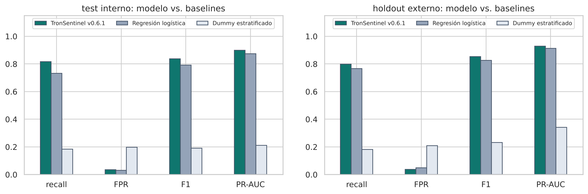

# TronSentinel · Priorización de wallets TRON para revisión humana


TronSentinel analiza los **90 días de transferencias USDT/TUSD** de una wallet de la red TRON y estima qué tan parecido
es su comportamiento al de las wallets que **después fueron congeladas por Tether**. Usa un único clasificador
explicable (gradient boosting de árboles de profundidad 1 con calibración Platt) y está desplegado como API + interfaz
web en **modo SHADOW**: prioriza la revisión humana y nunca ejecuta acciones automáticas.

**Aplicación:** <https://pry-tronsentinel.web.app> · **Proyecto Integrador en Inteligencia Artificial · UEES · 2026**


## Tabla de contenidos

1. [Descripción del problema](#1-descripción-del-problema)
2. [Dataset](#2-dataset)
3. [Metodología](#3-metodología)
4. [Resultados](#4-resultados)
5. [Instalación y uso](#5-instalación-y-uso)
6. [Interfaz de usuario](#6-interfaz-de-usuario)
7. [Estructura del proyecto](#7-estructura-del-proyecto)
8. [Consideraciones éticas](#8-consideraciones-éticas)
9. [Autores y contribuciones](#9-autores-y-contribuciones)
10. [Licencia](#10-licencia)
11. [Agradecimientos y referencias](#11-agradecimientos-y-referencias)
12. [Videos](#12-videos)

## 1. Descripción del problema

**¿Qué resuelve?** USDT en TRON mueve grandes volúmenes con comisiones bajas y es muy usado en estafas y lavado. Tether
puede congelar una dirección incluyéndola en su blacklist, pero eso ocurre **después** del daño, y las transferencias en
blockchain son irreversibles. TronSentinel responde, con datos públicos y antes de transaccionar: *¿esta wallet se
comporta como las que luego fueron congeladas?*

**¿Por qué importa?** Una advertencia previa puede evitar una pérdida; un analista puede ordenar su trabajo por señal en
lugar de revisar al azar; y en Ecuador la Ley Orgánica de Prevención de Lavado de Activos (2024) incorporó a los
proveedores de activos virtuales como sujetos obligados con debida diligencia basada en riesgo.

**Usuarios objetivo:** personas que van a enviar o recibir USDT y quieren revisar una dirección; analistas de riesgo,
fraude y cumplimiento; equipos de soporte; desarrolladores que integran la API. **No** está pensado para uso policial
autónomo ni para negar servicios sin revisión humana.

Más detalle en [`docs/planificacion.md`](docs/planificacion.md).

## 2. Dataset

| | |
|---|---|
| **Fuente** | Blockchain pública TRON vía la API de [TronGrid](https://www.trongrid.io/): transferencias USDT-TRC20 y TUSD, y eventos `AddedBlackList` de Tether como etiqueta |
| **Licencia** | Datos públicos on-chain (uso de TronGrid sujeto a sus términos). Dataset procesado publicado con el repositorio (MIT) con fines académicos |
| **Diseño** | *Risk set* caso-control punto en el tiempo: cada wallet que luego fue congelada (caso) se compara con 2–4 wallets activas en la **misma fecha** (controles), usando solo eventos **anteriores** a esa fecha |
| **Tamaño** | 1 854 filas de desarrollo (400 casos, 1 454 controles) + 286 del holdout externo (99 / 187) |
| **Variables** | 38 numéricas en 8 familias: actividad, dirección del flujo, montos, contrapartes, concentración, autotransferencias, activos y temporalidad |
| **Particiones** | Cronológicas y por grupo caso-control: train 1 294 · validación 278 · test 282 · holdout externo 286 (wallets distintas) |
| **Calidad** | 0 faltantes, 0 duplicados, 0 eventos posteriores a la fecha índice, 0 wallets compartidas entre desarrollo y holdout |
| **Datos** | [`data/processed/`](data/processed/) (públicos en este repositorio) · diccionario en [`data/README.md`](data/README.md) |

Análisis exploratorio completo (7 gráficos, outliers, correlaciones, desbalance y el **sesgo de recencia** de los
controles) en [`docs/analisis_datos.md`](docs/analisis_datos.md).

## 3. Metodología

| Etapa | Decisión | Justificación |
|---|---|---|
| **Modelo** | Gradient Boosting de 150 stumps (profundidad 1), `learning_rate` 0,04, `min_samples_leaf` 20, `subsample` 0,8 | En el grupo de mejor rendimiento en validación junto a Random Forest y GB profundo; aditivo → **explicación exacta por variable**; exportable a JSON y ejecutado por la API en TypeScript |
| **Preprocesamiento** | Sin imputación (historias incompletas → `NOT_SCORABLE`), sin escalado para árboles (`log1p` + estandarización solo para el baseline lineal), outliers reales conservados, validación automática anti-fuga | Ver [`02_preprocesamiento.ipynb`](notebooks/02_preprocesamiento.ipynb) |
| **Desbalance** | Pesos balanceados por clase dentro de cada `fit`; PR-AUC como métrica principal | La prevalencia muestral es 22 % y la real ≈ 1 % |
| **Calibración y umbral** | Platt en validación; umbral = máximo F1 con FPR ≤ 5 % en validación → `0,4288828974` | El umbral se congeló antes de abrir el holdout externo |
| **Optimización** | Optuna TPE (60 pruebas, GroupKFold por caso), importancia fANOVA, partial dependence y análisis de interacciones; 5 escenarios críticos (ruido, faltantes, prevalencia, cambio de distribución, fraccionamiento) | Ninguna configuración supera a la desplegada con significancia: se mantiene ([`docs/optimizacion.md`](docs/optimizacion.md)) |
| **Evaluación** | Recall, FPR, precisión, F1, ROC-AUC, PR-AUC (nulo = prevalencia), Brier; IC de Wilson y bootstrap agrupado por caso; precisión a prevalencia real; auditoría por subgrupos | Test interno + **holdout externo de una sola apertura** registrado en [`governance/data-openings.json`](governance/data-openings.json) |

Arquitectura del modelo y del sistema: [`docs/arquitectura.md`](docs/arquitectura.md) · Ficha técnica: [`docs/MODEL_CARD.md`](docs/MODEL_CARD.md)

## 4. Resultados

Modelo congelado `tronsentinel-onchain-riskset-v0.6.1-20260928`, umbral `0,4289`. Baselines entrenados en train con el
umbral elegido en validación por la misma regla ([`05_evaluacion.ipynb`](notebooks/05_evaluacion.ipynb)).

| Holdout externo (n = 286) | Recall [IC 95 %] | FPR [IC 95 %] | Precisión | F1 | ROC-AUC | PR-AUC |
|---|---|---|---:|---:|---:|---:|
| Dummy estratificado | 0,182 | 0,209 | 0,316 | 0,231 | 0,487 | 0,341 |
| Regresión logística (baseline v1) | 0,768 [0,675–0,840] | 0,048 [0,026–0,089] | 0,894 | 0,826 | 0,956 | 0,913 |
| **TronSentinel v0.6.1** | **0,798 [0,708–0,865]** | **0,037 [0,018–0,075]** | **0,919** | **0,854** | **0,962** | **0,929** |

| Test interno (n = 282) | Recall | FPR | Precisión | F1 | ROC-AUC | PR-AUC (nulo) |
|---|---:|---:|---:|---:|---:|---:|
| Regresión logística | 0,733 | 0,032 | 0,863 | 0,793 | 0,950 | 0,874 |
| **TronSentinel v0.6.1** | **0,817** | 0,036 | 0,860 | **0,838** | **0,967** | **0,899** (0,213) |



**Lectura honesta de los resultados:**

* Detecta 79 de 99 wallets riesgosas con 7 falsas alarmas en 187 legítimas. Supera claramente al azar y, en el umbral
  operativo, a la regresión logística (más recall con menos falsas alarmas), aunque en ranking (PR-AUC) la diferencia
  es pequeña.
* **Con una prevalencia real del 1 %, solo ~18 de cada 100 alertas serían verdaderas.** Por eso solo prioriza revisión.
* **Falla en wallets de bajo volumen:** recall 0,37 (IC 0,19–0,59) en el tercil inferior.
* **Las métricas son un límite superior:** los controles se muestrearon activos en los 300 s previos, lo que infla la
  variable de recencia. El candidato v0.7 sin esa variable obtuvo recall 0,51 y fue rechazado
  ([`governance/cycles/v7/`](governance/cycles/v7/)); el ciclo v8 corrige el muestreo.

## 5. Instalación y uso

### Requisitos

* Python **3.12 o superior** (probado con 3.13) y `pip`.
* Opcional: Node.js 22 y Firebase CLI, solo para reconstruir datos o desplegar la API.
* Sistema operativo: macOS, Linux o Windows. No se requiere GPU (el entrenamiento toma segundos).

### Instalación

```bash
git clone https://github.com/cvramire/TronSentinel-api.git
cd TronSentinel-api
python -m venv .venv
source .venv/bin/activate            # Windows: .venv\Scripts\activate
pip install -r requirements.txt
```

### Comandos principales

```bash
python -m src.train                          # entrena, guarda models/best_model.pkl y model_v1.pkl, verifica paridad
python -m src.evaluate --split validation    # métricas con IC (también: test, external_holdout — solo informativo)
pytest                                       # 23 pruebas: datos, modelo y aplicación
python app/app.py                            # aplicación local en http://127.0.0.1:8080
jupyter notebook notebooks/                  # notebooks 01 → 05
```

Salida esperada de `python -m src.train`:

```text
Validación · umbral 0.4289 · recall 0.917 · FPR 0.041 · PR-AUC 0.935 · paridad {'checked': True, 'maxAbsProbabilityDifference': 2.2e-16, 'sameThreshold': True}
```

### Ejemplos de uso

**Desde Python**

```python
import joblib, pandas as pd
from src.data_processing import FEATURE_NAMES

modelo = joblib.load("models/best_model.pkl")
wallets = pd.read_csv("app/assets/ejemplo_wallets.csv")
wallets["probabilidad"] = modelo.predict_proba(wallets[FEATURE_NAMES])
wallets["revision"] = modelo.predict(wallets[FEATURE_NAMES])
print(wallets[["address", "target", "probabilidad", "revision"]])
print(modelo.explain(wallets[FEATURE_NAMES].head(1)))   # top-5 contribuciones al logit
```

**Desde la API desplegada (demo pública, sin clave)**

```bash
API=https://us-central1-pry-tronsentinel.cloudfunctions.net/TRONSENTINEL
curl -s $API/demo/examples
curl -s -X POST $API/demo/score -H 'content-type: application/json' -d '{"exampleId":"detected-risk"}'
```

**Evaluar cualquier wallet (requiere clave, entregada en privado)**

```bash
curl -s -X POST $API/v1/score/wallet/shadow/live \
  -H 'content-type: application/json' -H "x-api-key: $TRONSENTINEL_API_KEY" \
  -d '{"address":"TY4D33GnRACD8gnXyDhLnDpbeYaT8SY55D"}'
```

### Backend, datos y despliegue

* API (TypeScript, Firebase Functions): `cd functions && npm ci && npm test`.
* Despliegue: `firebase deploy --only functions,hosting --project pry-tronsentinel`.
* Reconstruir el pipeline de datos y entrenar un nuevo candidato: [`docs/TRAINING_RUNBOOK.md`](docs/TRAINING_RUNBOOK.md)
  y [`docs/TRAINING_GOVERNANCE.md`](docs/TRAINING_GOVERNANCE.md). Detalles del backend: [`docs/BACKEND_API.md`](docs/BACKEND_API.md).

## 6. Interfaz de usuario

**Link:** <https://pry-tronsentinel.web.app> — HTML/CSS/JS sin dependencias en Firebase Hosting, conectado a la API en
Cloud Functions (opción "Flask + HTML/CSS" de la guía: la versión local se sirve con [`app/app.py`](app/app.py)).

| Funcionalidad | Cómo se cumple |
|---|---|
| Input y validación | Dirección TRON con validación de formato (Base58, 34 caracteres, empieza con `T`); clave de acceso para evaluación libre |
| Ejemplos precargados | 5 wallets reales del holdout externo + botón **Prueba con ejemplo** (sin clave) |
| Procesamiento | Indicador de carga con la wallet consultada; manejo de errores en lenguaje común (dirección inválida, clave inválida, sin actividad, historial truncado, límite de consultas) |
| Output | Score 0–100, banda, probabilidad muestral, umbral, decisión, 5 factores con barras, calidad del historial, verdad conocida del ejemplo |
| Acerca del modelo | Métricas con IC, precisión por prevalencia, limitaciones, usos prohibidos y ficha técnica en vivo |
| Extras | Responsive (móvil y escritorio), tema claro/oscuro, exportación CSV/PDF/JSON, historial de la sesión para comparar, enlace a Tronscan |
| App local | `/local`: evaluador offline por CSV con el mismo artefacto |

| Inicio | Falso negativo (limitación) | Móvil |
|---|---|---|
|  |  |  |

**Cómo usarla:** abre el link → pulsa **Prueba con ejemplo** (o una tarjeta) → lee el score, la decisión y los factores
→ revisa la tarjeta con la etiqueta real → consulta **Acerca del modelo**. Para una wallet propia usa la pestaña **Mi
wallet (con clave)**. Guía completa con capturas anotadas, solución de problemas y FAQ:
[`docs/manual_usuario.md`](docs/manual_usuario.md).

## 7. Estructura del proyecto

```text
TronSentinel-api/
├── README.md · requirements.txt · config.yaml · LICENSE · .gitignore · pytest.ini
├── docs/            # planificación, análisis de datos, arquitectura, optimización, ética, manual, model card, gobernanza
│   └── img/         # capturas de la interfaz
├── data/            # raw/ (no versionado, ver README) · processed/ (datasets v6) · README.md (diccionario)
├── notebooks/       # 01_exploracion · 02_preprocesamiento · 03_modelado · 04_optimizacion · 05_evaluacion
├── src/             # data_processing · model · train · evaluate · utils
├── models/          # model_v0.6.1.json (desplegado) · best_model.pkl · model_v1.pkl (baseline) · README.md
├── app/             # app.py (Flask: interfaz + evaluador local) · requirements.txt · assets/
├── tests/           # test_data_processing · test_model · test_app (pytest)
├── results/         # figures/ (eda, modelado, optimizacion, evaluacion) · metrics/ (CSV) · reports/
├── front/           # interfaz web desplegada en Firebase Hosting
├── functions/       # API TypeScript (Cloud Functions) + scripts del pipeline de datos y entrenamiento
├── governance/      # registro de aperturas de test/holdout, manifiestos y evidencias por ciclo
└── firebase.json · firestore.rules · firestore.indexes.json
```

| Carpeta | Contenido |
|---|---|
| `src/` | Código Python modular: validación de datos, definición del modelo (`TronSentinelModel`), entrenamiento reproducible, métricas con IC |
| `notebooks/` | Ciclo completo ejecutado, con resultados y conclusiones |
| `app/` + `front/` | Interfaz web (desplegada) y servidor local Flask |
| `functions/` | Backend en producción: rutas, scorer, proveedor TronGrid, Firestore; scripts Node/Python para datos |
| `governance/` | Trazabilidad: qué particiones se abrieron, cuándo y para qué |
| `results/` | Figuras, métricas y reportes generados por los notebooks y los diagnósticos |

## 8. Consideraciones éticas

* **Sesgos:** sin variables demográficas, pero con sesgos de construcción: la etiqueta (blacklist de Tether) es un proxy;
  los controles se muestrearon con recencia ≈ 0 (infla métricas); el modelo depende de montos y detecta peor el bajo
  volumen.
* **Equidad:** auditoría por subgrupos de volumen, actividad y antigüedad con IC; diferencia significativa solo en bajo
  volumen (recall 0,37), comunicada en la interfaz.
* **Privacidad:** solo datos públicos on-chain (seudónimos); sin datos personales del consultante; clave guardada como
  hash; Firestore cerrado a clientes; alineado con la LOPDP de Ecuador y la norma SPDP para IA.
* **Transparencia:** contribución exacta por variable, lenguaje común, model card público, métricas con incertidumbre.
* **Responsabilidad:** modo SHADOW, revisión humana obligatoria, registro de aperturas de datos, criterios de pausa y
  reentrenamiento trimestral.

**Limitaciones y advertencias de uso:**

> ⚠️ **No usar** TronSentinel para bloquear, congelar o rechazar fondos o clientes automáticamente, para acusar a una
> persona, para sustituir la debida diligencia KYC/AML, ni para evaluar exchanges o servicios de muy alto volumen. Un
> score alto **no** es una probabilidad de delito y "no requiere revisión" **no** significa "segura".

Análisis completo (8 dimensiones): [`docs/consideraciones_eticas.md`](docs/consideraciones_eticas.md).

## 9. Autores y contribuciones

| Integrante | Rol |
|---|---|
| **Carlos Vladimir Ramírez Espinoza** | Arquitectura del sistema, pipeline de datos on-chain, modelado, API y despliegue en Firebase |
| **Madheline Katerine Torres Hallo** | Análisis exploratorio, evaluación del modelo, consideraciones éticas y documentación |

Ambos integrantes participaron en la definición del problema, las decisiones de diseño y la revisión de resultados.
**Docente:** PhD. (c) Gladys Villegas · Proyecto Integrador en Inteligencia Artificial · Universidad de Especialidades
Espíritu Santo (UEES).

## 10. Licencia

Código y documentación bajo licencia [MIT](LICENSE). Los datos on-chain son públicos; su obtención mediante TronGrid
está sujeta a los términos de ese servicio. El uso del modelo está sujeto a las limitaciones de la sección 8.

## 11. Agradecimientos y referencias

Agradecemos a la PhD. (c) Gladys Villegas por la retroalimentación en cada workshop, y a TronGrid y Tronscan por el
acceso público a los datos de la red TRON.

* Friedman, J. H. (2001). Greedy function approximation: a gradient boosting machine. *Annals of Statistics*, 29(5), 1189–1232.
* Platt, J. (1999). Probabilistic outputs for support vector machines and comparisons to regularized likelihood methods. *Advances in Large Margin Classifiers*.
* Saito, T. y Rehmsmeier, M. (2015). The precision-recall plot is more informative than the ROC plot when evaluating binary classifiers on imbalanced datasets. *PLOS ONE*, 10(3).
* Akiba, T. et al. (2019). Optuna: a next-generation hyperparameter optimization framework. *KDD '19*.
* Hutter, F., Hoos, H. y Leyton-Brown, K. (2014). An efficient approach for assessing hyperparameter importance (fANOVA). *ICML*.
* Mitchell, M. et al. (2019). Model cards for model reporting. *FAT* '19*.
* Pedregosa, F. et al. (2011). Scikit-learn: machine learning in Python. *JMLR*, 12, 2825–2830.
* National Institute of Standards and Technology (2023). *AI Risk Management Framework (AI RMF 1.0)*.
* Asamblea Nacional del Ecuador (2021, 2024). Ley Orgánica de Protección de Datos Personales; Ley Orgánica de Prevención, Detección y Combate del Delito de Lavado de Activos.
* Tether. USDT-TRC20 (`TR7NHqjeKQxGTCi8q8ZY4pL8otSzgjLj6t`) · TronGrid API: <https://developers.tron.network/>

## 12. Videos

* 🎬 **Video pitch (5 min):** _enlace pendiente_
* 🎤 **Video de respuestas a las preguntas:** _enlace pendiente_
