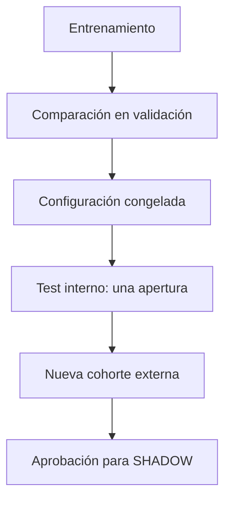

# Gobernanza de entrenamiento y evaluación — TronSentinel

Vigente desde octubre de 2026 para toda versión candidata posterior a `tronsentinel-onchain-riskset-v0.6.1-20260928`.

## Decisión vigente

Se mantiene `v0.6.1` con el artefacto `tronsentinel-wallet-shadow-v0.7.0-20260928` en modo `SHADOW`, umbral `0.4288828973999436`, sin acciones automáticas. **No se modifican el modelo ni el umbral.** El diagnóstico corregido de overfitting no demuestra que otra configuración sea estadísticamente superior, y cambiar ahora sería una decisión post hoc.

Lo que cambia es el proceso para entrenar la próxima versión candidata (`v0.7.x` / `v0.8.x`). Esa versión se entrena solo cuando exista una **nueva cohorte temporal** que permita validarla sin reutilizar el holdout anterior.

## Flujo obligatorio



Después de consultar el test no se vuelve atrás para escoger otra estrategia. Si el test revela una debilidad, se registra y se inicia un nuevo ciclo con datos futuros.

| Paso | Herramienta | Partición usada |
|---|---|---|
| Entrenamiento y selección de estimadores | `train-onchain-model.py` | train + validation (test sellado) |
| Comparación de regularización | `diagnose_overfitting.py` | validation |
| Apertura única del test interno | `confirm-onchain-test.py --partition internal-test` | test (registrado en el ledger) |
| Holdout externo nuevo | `confirm-onchain-test.py --partition external-holdout` | nueva cohorte (registrada) |

## 1. Selección de estimadores

- Búsqueda hasta `--max-estimators 1000`. La grilla `150, 300, 500, 700, 900, 1.000` se reporta en validación, pero no decide por sí sola.
- Seguimiento externo con `staged_predict_proba` sobre validación.
- Regla predefinida: paciencia de 50 iteraciones y mejora mínima `1e-4` en el log loss de validación. Se selecciona la última iteración que mejoró al menos `min_delta`.
- No se usa el early stopping interno de scikit-learn (`n_iter_no_change` / `validation_fraction`), porque separa una fracción aleatoria por filas. Eso rompe el diseño cronológico agrupado por `matchedCaseId`.
- Si la regla no se activa antes del máximo, el check `earlyStoppingConvergedBeforeSearchMaximum` falla y hay que ampliar la búsqueda antes de congelar.
- **No se fija `n_estimators=914`.** Ese valor es el mínimo absoluto observado con la validación actual y es exploratorio. Con la regla predefinida, la semilla primaria se detiene en 825; con 10 semillas, el punto óptimo varía entre 516 y 845.
- `--estimator-selection fixed --estimators 150` reproduce v0.6.1 (stumps idénticos) y sirve solo como modo de reproducción.

## 2. Regla de subajuste

Se elimina `validation_pr_auc < 0.50`. El PR-AUC de un clasificador sin información es la prevalencia de la partición:

```python
null_pr_auc = positive_prevalence
improvement = validation_pr_auc - null_pr_auc
```

Hay posible subajuste si el límite inferior del IC 95 % no supera la prevalencia en al menos `--min-pr-auc-lift` (0,10 por defecto). Líneas base actuales: validación `0,2158`, test `0,2128`.

## 3. Bootstrap agrupado

`onchain_governance.grouped_bootstrap` remuestrea grupos `matchedCaseId` completos, no filas, y reporta con IC 95 %:

- PR-AUC y ROC-AUC;
- recall y FPR en el umbral del modelo;
- diferencias pareadas entre modelos sobre los mismos remuestreos.

Una estrategia se declara superior solo si el IC de su diferencia pareada excluye cero.

## 4. Semillas

| Uso | Semillas |
|---|---|
| Evaluación académica (`diagnose_overfitting.py`) | 30 |
| Validación rápida (`train-onchain-model.py --stability-seeds`) | 10 |

Las configuraciones con `subsample < 1` son estocásticas y siempre se repiten. Las deterministas (`subsample = 1`) pueden usar una sola semilla con `--deterministic-single-seed`; por defecto se repiten para uniformidad del reporte. El modelo exportado usa siempre la semilla primaria `20260927`.

## 5. Experimentos de regularización

| Experimento | `max_depth` | `min_samples_leaf` | `subsample` |
|---|---:|---:|---:|
| Base compleja | 3 | 1 | 1,0 |
| Stumps | 1 | 1 | 1,0 |
| Solo leaf | 1 | 20 | 1,0 |
| Solo subsample | 1 | 1 | 0,8 |
| Combinada (desplegada) | 1 | 20 | 0,8 |

La referencia de las diferencias pareadas es la configuración desplegada. El artefacto productivo solo admite stumps (`max_depth = 1`), así que la base compleja es una comparación diagnóstica y no un candidato desplegable.

## 6. Prohibición de selección mediante test

- `train-onchain-model.py` ya no calcula métricas de test; la decisión de gobernanza es `READY_FOR_FREEZE` o `REJECTED`.
- `confirm-onchain-test.py` exige `READY_FOR_FREEZE`. Registra la apertura en `governance/data-openings.json` **antes** de calcular métricas y rechaza una segunda apertura del mismo dataset.
- `diagnose_overfitting.py` no abre test salvo `--include-test`. En ese caso la selección ya está fijada, y si el test figura como consumido el resultado se marca `CONSUMED_REPORT_ONLY`.

## 7. Particiones consumidas

`governance/data-openings.json` registra como consumidos:

- el test interno del dataset de desarrollo `1039cb72…` (v0.6.1 y diagnóstico de la Semana 3);
- el holdout externo `external-holdout-dataset.csv` (`c144de87…`) y sus archivos fuente de positivos (`d30562b5…`) y controles (`813867eb…`).

Ninguno puede usarse para escoger 150 frente a 914 estimadores, ajustar profundidad, modificar el umbral, seleccionar regularización ni recalibrar percentiles. Un candidato entrenado sobre el mismo dataset de desarrollo no puede confirmarse en ese test. Necesita un dataset de desarrollo nuevo (nuevo hash) o, como mínimo, una cohorte temporal externa nueva.

## Comandos

```bash
cd functions
# Entrenar un candidato (test sellado)
python3 scripts/train-onchain-model.py \
  --dataset <dataset.csv> --manifest <manifest.json> \
  --output-dir <salida> --model-version tronsentinel-onchain-riskset-v0.7.0-YYYYMMDD

# Diagnóstico académico (30 semillas, 5.000 bootstrap)
python3 scripts/diagnose_overfitting.py --dataset <dataset.csv> --manifest <manifest.json> --output-dir <salida>

# Apertura única del test interno del candidato congelado
python3 scripts/confirm-onchain-test.py --model <salida>/model-challenger-onchain.json \
  --dataset <dataset.csv> --partition internal-test --output-dir <salida> --purpose "Confirmación v0.7.0"

# Pruebas de las reglas
npm run test:governance
```
