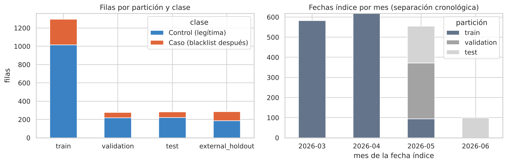
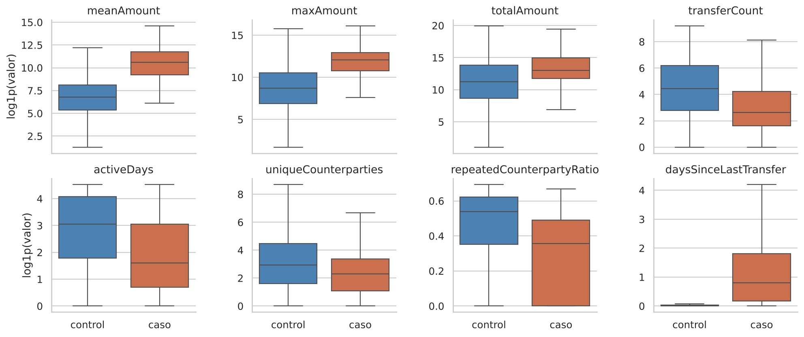
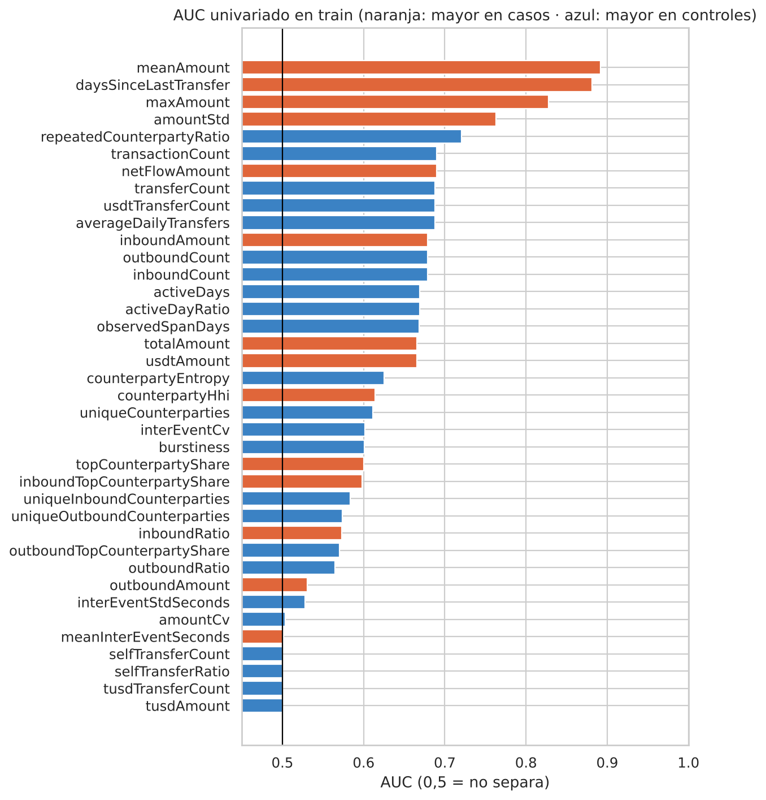
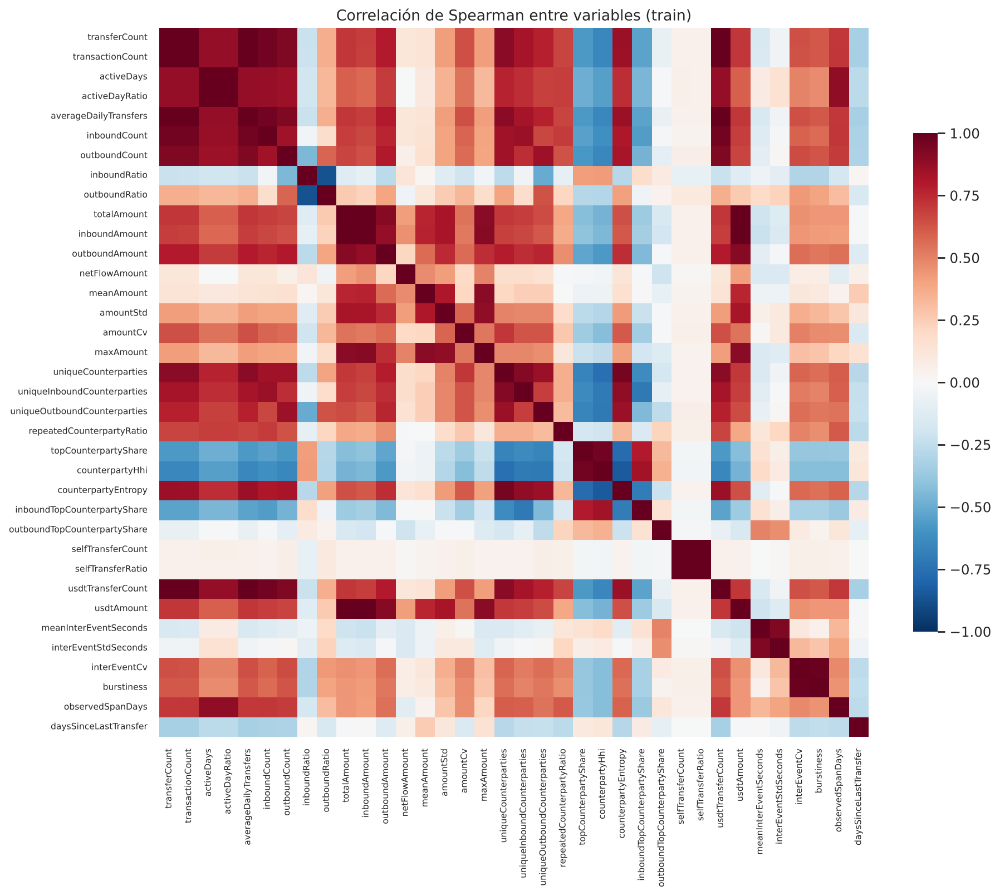
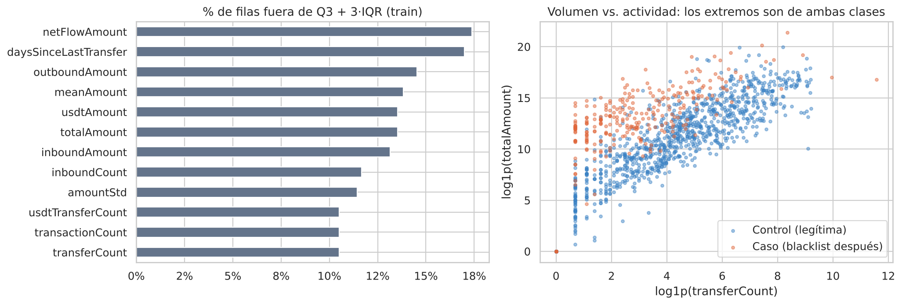
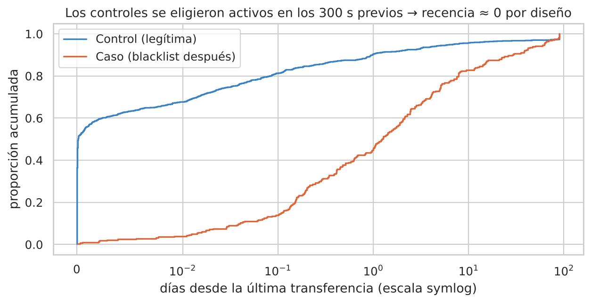
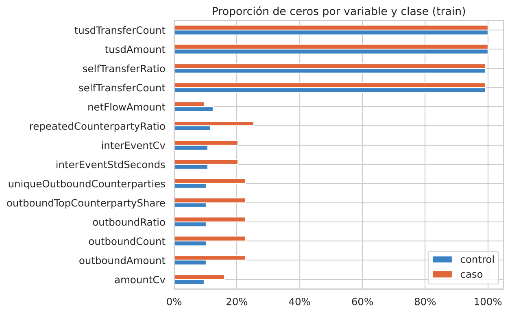

# Análisis exploratorio de datos

Notebooks: [`01_exploracion.ipynb`](../notebooks/01_exploracion.ipynb) y
[`02_preprocesamiento.ipynb`](../notebooks/02_preprocesamiento.ipynb) · Diccionario de datos: [`data/README.md`](../data/README.md)

> Todas las decisiones de preprocesamiento se tomaron mirando **solo la partición de entrenamiento** (1 294 filas).
> Validación, test y holdout externo se describen únicamente por tamaño y fechas.

## 1. Descripción del dataset

| Característica | Valor |
|---|---|
| Unidad de análisis | Wallet TRON evaluada en una fecha índice |
| Filas | 1 854 de desarrollo + 286 del holdout externo |
| Variables predictoras | 38 numéricas (27 continuas, 11 conteos enteros) en 8 familias |
| Etiqueta | `target` = 1 si la wallet fue incluida después en la blacklist de Tether |
| Casos / controles | 400 / 1 454 en desarrollo (1 caso : 3,6 controles) · 99 / 187 en el holdout |
| Ventana de observación | 90 días antes de la fecha índice |
| Periodo | Fechas índice entre el 16-mar-2026 y el 09-jun-2026 |
| Fuente | Transferencias USDT/TUSD públicas obtenidas con TronGrid |

| Partición | Filas | Riesgosas | Prevalencia | Fechas índice |
|---|---:|---:|---:|---|
| train | 1 294 | 280 | 0,216 | 16-mar → 04-may |
| validation | 278 | 60 | 0,216 | 04-may → 14-may |
| test | 282 | 60 | 0,213 | 14-may → 09-jun |
| external_holdout | 286 | 99 | 0,346 | 25-may → 09-jun (wallets distintas) |

*Gráfico 1. Filas por partición y clase (izquierda) y meses de las fechas índice (derecha). Las particiones de desarrollo
son cronológicas: el modelo se entrena con el pasado y se evalúa hacia adelante.*

## 2. Estadísticas descriptivas

Medianas por clase en train (tabla completa en `results/metrics/eda_medianas_por_clase.csv`):

| Variable | Mediana control | Mediana caso | Razón caso/control |
|---|---:|---:|---:|
| `meanAmount` (USDT) | 872 | 40 441 | 46,4 |
| `maxAmount` (USDT) | 6 000 | 178 236 | 29,7 |
| `totalAmount` (USDT) | 78 555 | 448 997 | 5,7 |
| `transferCount` | 84 | 13 | 0,15 |
| `activeDays` | 20 | 4 | 0,20 |
| `uniqueCounterparties` | 18 | 9 | 0,50 |
| `repeatedCounterpartyRatio` | 0,71 | 0,43 | 0,60 |
| `daysSinceLastTransfer` | 0,00 | 1,24 | — |

* **Asimetría extrema:** `transferCount`, `outboundCount` y los montos tienen asimetría entre 25 y 33; la media de
  `totalAmount` (7,2 M USDT) es 48 veces su mediana (151 065 USDT). Por eso se describen con medianas y percentiles.
* **Variables casi constantes:** `tusdTransferCount` y `tusdAmount` son 0 en todo train; las autotransferencias son 0
  en el 99 % de las filas.
* **Wallets sin actividad:** 51 filas (2,8 %) no tienen transferencias en la ventana. En producción estas wallets
  responden `NOT_SCORABLE (INSUFFICIENT_HISTORY)` en lugar de un score.

## 3. Visualizaciones y patrones

### 3.1 Distribuciones por clase

*Gráfico 2. Variables clave en escala `log1p` (sin outliers en el dibujo).* Las wallets que luego entran a la blacklist
hacen **menos transferencias, en menos días y con menos contrapartes repetidas, pero de montos mucho mayores**. Es un
patrón coherente con wallets de paso que concentran fondos antes de ser congeladas.

### 3.2 Poder separador individual

*Gráfico 3. AUC de cada variable por separado (naranja: valores mayores en casos; azul: mayores en controles).*
`meanAmount` (0,89), `daysSinceLastTransfer` (0,88) y `maxAmount` (0,83) son las más separadoras. Ninguna variable
de concentración supera 0,63 por sí sola, y las de ritmo temporal (aparte de la recencia) quedan entre 0,50 y 0,67.

### 3.3 Correlaciones

*Gráfico 4. Correlación de Spearman entre las 36 variables no constantes.* Hay **18 pares con |ρ| ≥ 0,95**: bloques
de conteos (`transferCount` = `transactionCount` = `usdtTransferCount` = `averageDailyTransfers`), de montos
(`totalAmount` = `usdtAmount`) y de proporciones (`activeDays` ↔ `activeDayRatio`). Para árboles la redundancia no
empeora la predicción, pero reparte la importancia entre variables equivalentes; por eso la interpretación se hace
por familias y se conservan las 38 variables (la API calcula exactamente ese vector).

### 3.4 Valores atípicos

*Gráfico 5. Porcentaje de filas fuera de Q3 + 3·IQR (izquierda) y volumen vs. actividad (derecha).* Entre 10 % y 18 %
de las filas son atípicas en montos y conteos. Son **valores reales** (exchanges, servicios de pago, wallets de paso
con millones de USDT) y aparecen en ambas clases: el máximo de transferencias es 9 972 en controles y 106 597 en casos.

### 3.5 Recencia y sesgo de selección

*Gráfico 6. Distribución acumulada de `daysSinceLastTransfer`.* El 67,7 % de los controles tiene recencia menor a
0,01 días, frente a una mediana de 1,24 días en los casos. La causa es el **diseño de muestreo**: los controles se
eligieron entre wallets con una transferencia en los 300 segundos previos a la fecha índice. La variable mide en
parte el diseño y no solo el riesgo; esto infla las métricas y se documenta como limitación (ver
[`MODEL_CARD.md`](MODEL_CARD.md) y [`consideraciones_eticas.md`](consideraciones_eticas.md)).

### 3.6 Ceros y variables poco informativas

*Gráfico 7. Proporción de ceros por clase.* Las variables de salida (`outbound*`) valen cero en ~13 % de las wallets
(solo reciben); TUSD y autotransferencias casi nunca ocurren.

## 4. Decisiones de preprocesamiento

| Hallazgo | Decisión | Justificación |
|---|---|---|
| 0 faltantes, 0 duplicados, 0 no finitos | Sin imputación | Las variables se calculan de eventos completos. Una historia incompleta se excluye y en producción es `NOT_SCORABLE`. Imputar 10 % de valores con la mediana baja el recall de 0,80 a 0,64 (Workshop S5). |
| Asimetría extrema | Sin transformación para el modelo de árboles; `log1p` + estandarización solo para el baseline lineal | Un stump compara `x ≤ umbral`: es invariante a transformaciones monótonas. La API envía las variables en su escala natural. |
| Outliers reales en ambas clases | No se eliminan ni se recortan | Eliminar wallets de alto volumen sesgaría el modelo contra un segmento real; los árboles son robustos a extremos. |
| Redundancia (18 pares ρ ≥ 0,95) | Se conservan las 38 variables | Mantiene paridad exacta con la API; la regularización (profundidad 1, `min_samples_leaf` 20, `subsample` 0,8) limita el sobreajuste. |
| Variables constantes (TUSD) | Se conservan | No afectan al modelo (ningún árbol las usa) y permiten incorporar TUSD si aparece actividad. |
| Grupos caso-control | Partición por `matchedCaseId` | Evita que un caso y sus controles queden en particiones distintas (fuga de información). |
| Orden temporal | Partición cronológica | Simula el uso real hacia adelante. |
| Posible fuga de etiqueta | Validación automática de nombres prohibidos | `validate_dataset()` rechaza variables con `blacklist`, `label`, `riskScore`, etc. |

## 5. Manejo del desbalance

* **En la muestra:** 1 caso por cada 3,6 controles (prevalencia 21,6 %). Se usan **pesos balanceados** dentro de cada
  `fit` (`balanced_sample_weights`: 2,31 por caso y 0,64 por control en train), de modo que cada clase aporta la misma
  masa a la pérdida. No se usa SMOTE: crearía wallets sintéticas sin semántica on-chain y mezclaría grupos.
* **En la evaluación:** la métrica principal es **PR-AUC**, cuyo valor nulo es la prevalencia (0,216 en validación);
  recall y FPR se reportan en el umbral operativo con intervalos de Wilson.
* **En producción:** la prevalencia real es mucho menor (≈ 1 %). Con el recall y el FPR medidos, la precisión esperada
  cae a ~18 %; la interfaz lo advierte y el sistema solo prioriza revisión humana.

## 6. Conclusiones

1. Datos completos y consistentes; las garantías de integridad se verifican automáticamente al cargar.
2. La señal más fuerte es monetaria (montos promedio y máximos altos con poca actividad).
3. La recencia está inflada por el diseño de muestreo; es la principal amenaza a la validez y se corrige en el ciclo v8
   con controles anclados en un instante aleatorio de la ventana (`--activity-anchor random-lookback`).
4. Las wallets de bajo volumen tienen menos señal monetaria; se espera (y se confirma en la evaluación) un peor recall
   en ese segmento.
