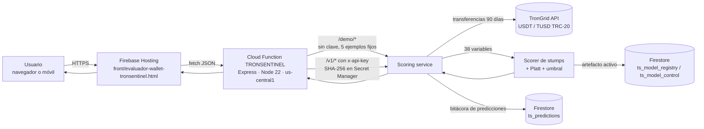
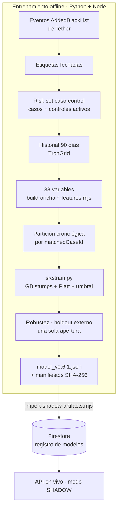

# Arquitectura del modelo y del sistema

## 1. Tipo de modelo y justificación

TronSentinel usa un **clasificador binario de Gradient Boosting con árboles de profundidad 1 (stumps)**, con pesos
balanceados por clase, **calibración Platt** y un **umbral de revisión congelado**.

| Criterio | Por qué GB de stumps |
|---|---|
| Rendimiento | En validación queda en el grupo de los mejores (PR-AUC 0,935 vs. 0,929 Random Forest y 0,949 GB prof. 3); las diferencias están dentro de la variación entre pliegues ([`03_modelado.ipynb`](../notebooks/03_modelado.ipynb)). |
| Datos tabulares, asimétricos y redundantes | Los árboles no requieren escalado, toleran outliers y variables correlacionadas. |
| Explicabilidad exacta | Cada stump usa una sola variable: el logit es una **suma de contribuciones por variable**, que la interfaz muestra sin aproximaciones (no hace falta SHAP). |
| Despliegue sin Python | El ensamble se exporta a JSON y lo evalúa un scorer TypeScript (`risk/classifier.ts`) en Cloud Functions, sin dependencias de ML. |
| Capacidad controlada | Con ~1 300 filas de entrenamiento, la profundidad 1 limita la memorización; la brecha train–validación es pequeña. |
| Alternativas descartadas | Regresión logística (menor recall con el mismo FPR), árbol simple (PR-AUC 0,83), redes neuronales (pocos datos, sin explicación exacta), GB profundo (no exportable al scorer actual y su mejora no es concluyente, Workshop S5). |

## 2. Arquitectura detallada del modelo

```text
Entrada: vector x de 38 variables (escala natural)
   │
   ├─ 150 stumps  h_k(x) = leftValue_k  si x[feature_k] ≤ threshold_k
   │                        rightValue_k en otro caso
   │
   ├─ Logit:       z = baseLogit + 0,04 · Σ_k h_k(x)          (baseLogit ≈ 0 por los pesos balanceados)
   ├─ Calibración: p = sigmoid(a · z + b),  a = 1,8490,  b = −1,9443   (Platt, ajustada en validación)
   ├─ Decisión:    revisión recomendada  ⇔  p ≥ 0,4288828974
   ├─ Score 0–100: percentil de p frente a 1 232 controles de train + validación
   └─ Explicación: contribución_j = 0,04 · Σ_{k: feature_k = j} h_k(x)
```

| Hiperparámetro | Valor | Rol |
|---|---|---|
| `n_estimators` | 150 | Número de correcciones aditivas |
| `learning_rate` | 0,04 | Tamaño de cada corrección |
| `max_depth` | 1 | Un corte por árbol (aditivo, sin interacciones) |
| `min_samples_leaf` | 20 | Evita reglas basadas en pocas wallets |
| `subsample` | 0,8 | Boosting estocástico (regularización) |
| `sample_weight` | n / (2·n_clase) | Igual masa para casos y controles |
| `random_state` | 20260927 | Reproducibilidad |

Solo 10 de las 38 variables entran en algún stump; `daysSinceLastTransfer` y `meanAmount` concentran la mayor parte
de la importancia (49,7 % y 44,4 % por impureza). Ver [`MODEL_CARD.md`](MODEL_CARD.md).

### Salidas del modelo

| Campo de la API | Significado | No significa |
|---|---|---|
| `sampleProbability` | Probabilidad calibrada en la muestra caso-control | Probabilidad real de fraude en producción |
| `riskScore` (0–100) y `riskLevel` | Percentil frente a controles (LOW ≤ 49, MEDIUM ≤ 79, HIGH ≤ 94, CRITICAL > 94) | Grado de culpabilidad |
| `reviewRecommended` | `sampleProbability ≥ umbral` | Orden de bloqueo |
| `contributions` | Top-5 variables por contribución absoluta al logit | Causalidad |

## 3. Diagrama del sistema completo





## 4. Pipeline de datos: de la entrada a la salida

| # | Etapa | Dónde | Detalle | Errores controlados |
|---|---|---|---|---|
| 1 | Entrada | Interfaz | Dirección TRON (o ejemplo precargado) y clave si aplica | Validación de formato Base58 de 34 caracteres que empieza con `T` |
| 2 | Autorización | `middleware/api-key.ts` | `/v1/*` compara el SHA-256 de `x-api-key`; `/demo/*` solo acepta 5 ids fijos y limita 30 consultas / 10 min por IP | `401 INVALID_API_KEY`, `400 UNKNOWN_EXAMPLE`, `429 DEMO_RATE_LIMITED` |
| 3 | Historial | `providers/trongrid.ts` | Transferencias USDT/TUSD de los 90 días previos a `asOf` (por defecto, ahora), paginadas | `422 HISTORY_TRUNCATED` si excede el límite de páginas |
| 4 | Variables | `risk/onchain-features.ts` | 38 variables con la misma semántica que en entrenamiento; montos inválidos se excluyen y se informan | `422 INSUFFICIENT_HISTORY` si no hay transferencias |
| 5 | Modelo | `risk/classifier.ts` | Suma de stumps → Platt → umbral → percentil → contribuciones | `MODEL_NOT_AVAILABLE` si no hay artefacto activo |
| 6 | Registro | `repositories/prediction-repository.ts` | Guarda dirección, versión, score y fecha (sin datos personales del consultante) | — |
| 7 | Salida | Interfaz | Score, banda, probabilidad, umbral, decisión, factores, calidad del historial, advertencias; exportación CSV/PDF/JSON | Mensajes de error en lenguaje común |

### Endpoints

| Método | Ruta | Acceso | Uso |
|---|---|---|---|
| GET | `/health` | público | Estado del servicio |
| GET | `/demo/examples` | público | Lista de 5 wallets reales del holdout externo |
| GET | `/demo/model` | público | Ficha técnica pública del modelo activo |
| POST | `/demo/score` | público | `{exampleId}` → evaluación en vivo en la fecha previa al etiquetado |
| GET | `/v1/model` · `/v1/model/shadow` | clave | Metadatos del artefacto |
| POST | `/v1/score/wallet/shadow/live` | clave | `{address, asOf?}` → evaluación en vivo (la usa la interfaz) |
| POST | `/v1/score/wallet` · `/v1/score/wallet/shadow` | clave | Evaluación desde snapshots almacenados |
| POST | `/v1/score/transaction` · `/shadow` | clave | `{from, to, amount?, timestamp?}` → evalúa remitente y destinatario con el mismo modelo |

Base: `https://us-central1-pry-tronsentinel.cloudfunctions.net/TRONSENTINEL`

### Configuración de la función

| Parámetro | Valor |
|---|---|
| Región | `us-central1` |
| Memoria / timeout | 1 GiB / 300 s |
| Concurrencia / instancias | 8 / máximo 1 (el limitador de la demo vive en memoria) |
| Secretos | `APP_TRONGRID_API_KEY` (Secret Manager); `APP_API_KEY_SHA256` solo como hash |
| CORS | Abierto (`origin: true`); la protección es la clave y la lista fija de ejemplos |
| Firestore | Reglas que niegan todo acceso desde clientes; solo la función (Admin SDK) lee y escribe |

## 5. Componentes del repositorio

| Carpeta | Rol |
|---|---|
| `src/` | Paquete Python: `data_processing`, `model` (incluye `TronSentinelModel`), `train`, `evaluate`, `utils` |
| `notebooks/` | EDA, preprocesamiento, modelado, optimización (S5) y evaluación final |
| `app/` | Aplicación Flask local: sirve la interfaz y un evaluador offline por CSV |
| `front/` | Interfaz web desplegada en Firebase Hosting (HTML + CSS + JS sin dependencias) |
| `functions/` | API en TypeScript (Cloud Functions) y scripts de datos/entrenamiento del pipeline completo |
| `governance/` | Registro de aperturas de particiones, manifiestos de datasets y evidencias de cada ciclo |
| `models/`, `data/`, `results/`, `tests/` | Artefactos, datos procesados, figuras/métricas/reportes y pruebas `pytest` |

## 6. Tecnologías y versiones

**Modelado y análisis (Python 3.13; requiere ≥ 3.12)** — versiones exactas en [`requirements.txt`](../requirements.txt)

| Librería | Versión | Uso |
|---|---|---|
| scikit-learn | 1.9.1 | `GradientBoostingClassifier`, baselines, métricas, calibración |
| numpy / pandas / scipy | 2.5.3 / 3.0.5 / 1.18.1 | Datos y cálculo numérico |
| optuna | 5.0.0 | Búsqueda TPE e importancia fANOVA (Workshop S5) |
| matplotlib / seaborn | 3.11.2 / 0.13.2 | Gráficos |
| joblib / PyYAML | 1.6.0 / 6.0.3 | Serialización de modelos y configuración |
| Flask | 3.1.3 | Aplicación local |
| pytest | 9.1.1 | Pruebas |

**API y despliegue (Node.js 22, TypeScript 6)** — `functions/package.json`

| Paquete | Versión | Uso |
|---|---|---|
| firebase-functions | ^7.2.5 | Cloud Functions v2 |
| firebase-admin | ^13.10.0 | Firestore desde la función |
| express | ^5.2.1 | Rutas HTTP |
| cors | ^2.8.6 | Cabeceras CORS |
| typescript / @typescript-eslint | ^6.0.3 / ^8.60.1 | Compilación y lint |

El cliente de TronGrid usa el `fetch` nativo de Node 22 y la validación de direcciones está en
`repositories/snapshot-repository.ts` (`normalizeTronAddress`).

**Infraestructura:** Firebase Hosting, Cloud Functions (2.ª gen.), Firestore, Secret Manager (proyecto `pry-tronsentinel`),
TronGrid como proveedor de datos on-chain.

## 7. Decisiones de diseño relevantes

* **Un solo clasificador.** No hay reglas manuales, componentes bayesianos ni ensambles paralelos: lo que se valida es
  exactamente lo que se despliega.
* **Paridad entrenamiento ↔ producción.** Las variables se calculan con la misma semántica en ambos lados; `src/train.py`
  reproduce el JSON desplegado con diferencia < 1e-15 y la prueba `tests/test_model.py` lo verifica.
* **Modo SHADOW.** El artefacto declara `productionProbabilityReady = false` y `automaticActionsAllowed = false`; la API
  no ejecuta ninguna acción sobre la wallet.
* **`NOT_SCORABLE` antes que un score degradado.** Si la historia está truncada o vacía, no se emite score.
* **Gobernanza de datos.** Cada apertura del test o del holdout queda registrada en `governance/data-openings.json` y esas
  particiones no se reutilizan para elegir modelos ([`TRAINING_GOVERNANCE.md`](TRAINING_GOVERNANCE.md)).
