# Manual de usuario · Evaluador de wallets TronSentinel

**Aplicación:** <https://pry-tronsentinel.web.app> · funciona en computador y en móvil, sin instalar nada.

TronSentinel analiza las transferencias USDT/TUSD de una wallet TRON durante los **90 días anteriores** a la fecha de
evaluación y estima **qué tan parecido es su comportamiento al de wallets que luego fueron congeladas por Tether**.
El resultado sirve para **decidir qué revisar primero**; no es una acusación ni una probabilidad de delito, y nunca
debe usarse para bloquear fondos por sí solo.

> Las capturas corresponden a la versión desplegada (el HTML capturado tiene el mismo SHA-256 que el publicado en
> Firebase Hosting) con respuestas reales de la API obtenidas el 23-oct-2026. Los números rojos son anotaciones de
> este manual.

## Contenido

1. [Pantalla de inicio](#1-pantalla-de-inicio)
2. [Probar con un ejemplo (sin clave)](#2-probar-con-un-ejemplo-sin-clave)
3. [Cómo leer el resultado](#3-cómo-leer-el-resultado)
4. [Los cinco ejemplos y lo que enseñan](#4-los-cinco-ejemplos-y-lo-que-enseñan)
5. [Evaluar cualquier wallet (con clave)](#5-evaluar-cualquier-wallet-con-clave)
6. [Exportar, copiar e historial](#6-exportar-copiar-e-historial)
7. [Acerca del modelo, tema oscuro y móvil](#7-acerca-del-modelo-tema-oscuro-y-móvil)
8. [Evaluador local por CSV (opcional)](#8-evaluador-local-por-csv-opcional)
9. [Solución de problemas](#9-solución-de-problemas)
10. [Preguntas frecuentes](#10-preguntas-frecuentes)
11. [Soporte y contacto](#11-soporte-y-contacto)

## 1. Pantalla de inicio

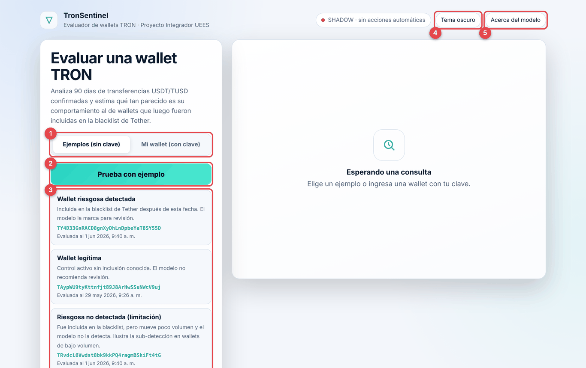

| # | Elemento | Para qué sirve |
|---|---|---|
| 1 | Pestañas **Ejemplos (sin clave)** / **Mi wallet (con clave)** | Elegir entre probar con ejemplos reales o evaluar una dirección propia |
| 2 | Botón **Prueba con ejemplo** | Ejecuta de inmediato el primer ejemplo (una wallet riesgosa detectada) |
| 3 | Tarjetas de ejemplo | Cinco wallets reales con su dirección completa y la fecha en que se evalúan |
| 4 | **Tema oscuro / claro** | Cambia el tema; la preferencia se recuerda en el navegador |
| 5 | **Acerca del modelo** | Lleva a la sección con métricas, limitaciones y usos prohibidos |

La etiqueta **SHADOW · sin acciones automáticas** recuerda que el sistema solo informa.

## 2. Probar con un ejemplo (sin clave)

1. Abre la aplicación; la pestaña **Ejemplos (sin clave)** está seleccionada.
2. Pulsa **Prueba con ejemplo** o haz clic en cualquier tarjeta.
3. Mientras se procesa verás **Consultando TronGrid y calculando 38 variables…** con la dirección de la wallet. La API
   descarga su historial real, calcula las variables y ejecuta el modelo (entre 5 y 30 segundos; los resultados de
   los ejemplos se guardan en caché 6 horas, así que la segunda vez son inmediatos).

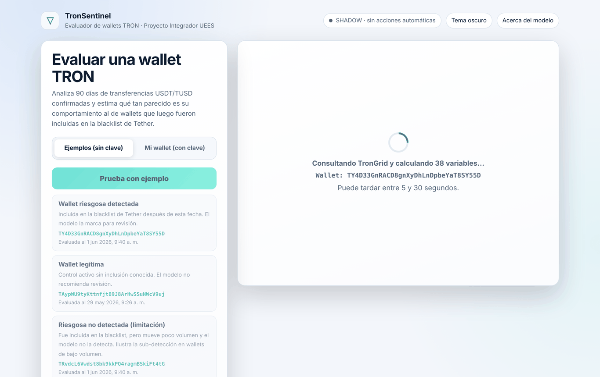

Cada ejemplo es una wallet **real** del holdout externo evaluada en la fecha previa a su etiquetado, así que puedes
comparar la predicción con lo que ocurrió después.

## 3. Cómo leer el resultado

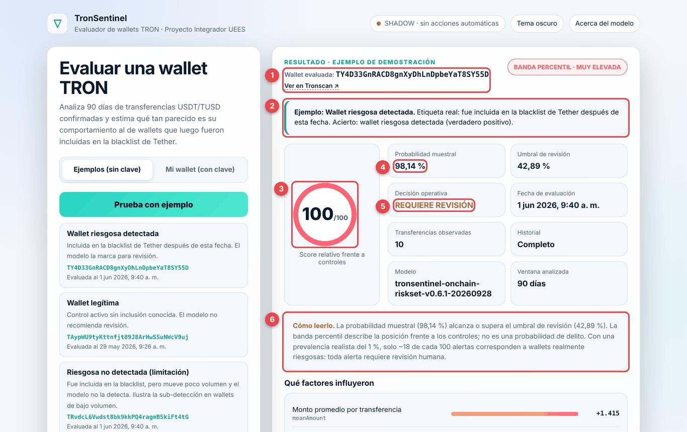

| # | Elemento | Cómo interpretarlo |
|---|---|---|
| 1 | **Wallet evaluada** + **Ver en Tronscan ↗** | Dirección completa; el enlace abre la wallet en el explorador público para verificarla |
| 2 | Tarjeta del ejemplo | Etiqueta real (incluida o no en la blacklist después) y si el modelo acertó: verdadero positivo, verdadero negativo, falso negativo o falsa alarma |
| 3 | **Score 0–100** y banda percentil | Posición frente a wallets de control. 100 = más parecida a los casos de riesgo que todos los controles. **No es un porcentaje de culpabilidad** |
| 4 | **Probabilidad muestral** | Salida calibrada en la muestra de entrenamiento (≈ 22 % riesgosas). Se compara con el umbral |
| 5 | **Decisión operativa** | **Requiere revisión** si la probabilidad ≥ umbral (42,89 %); si no, **No requiere revisión** |
| 6 | **Cómo leerlo** | Explicación en lenguaje común, con la advertencia de que con una prevalencia real del 1 % solo ~18 de cada 100 alertas son verdaderas |

Las otras tarjetas indican la fecha de evaluación, cuántas transferencias se observaron, si el historial estaba completo,
la versión del modelo y la ventana analizada.

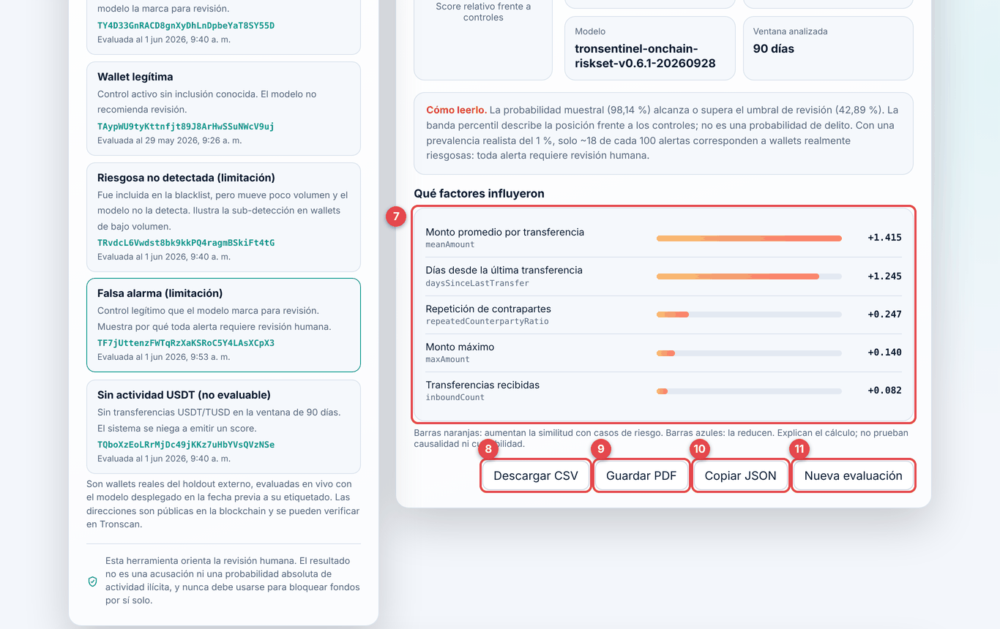

| # | Elemento | Cómo interpretarlo |
|---|---|---|
| 7 | **Qué factores influyeron** | Las 5 variables con más peso en esta wallet. Barra naranja y signo + aumentan la similitud con casos de riesgo; barra azul y signo − la reducen. Explican el cálculo, no prueban causalidad |
| 8 | **Descargar CSV** | Descarga un CSV campo–valor con wallet, fecha, modelo, score, probabilidad, umbral, decisión y contribuciones |
| 9 | **Guardar PDF** | Abre el diálogo de impresión con un formato limpio para guardar como PDF |
| 10 | **Copiar JSON** | Copia la respuesta completa de la API |
| 11 | **Nueva evaluación** | Limpia el resultado |

**Score alto pero "No requiere revisión":** es posible. El score es un percentil y la decisión usa la probabilidad
frente al umbral; una wallet puede estar por encima del 90 % de los controles sin alcanzar el umbral (ver ejemplo
"Riesgosa no detectada").

## 4. Los cinco ejemplos y lo que enseñan

| Ejemplo | Dirección | Resultado real del modelo | Lección |
|---|---|---|---|
| Wallet riesgosa detectada | `TY4D33GnRACD8gnXyDhLnDpbeYaT8SY55D` | Score 100, probabilidad 98,1 % → requiere revisión (acierto) | Caso típico: montos promedio altos y actividad reciente |
| Wallet legítima | `TAypWU9tyKttnfjt89J8ArHwSSuNWcV9uj` | Score 4, probabilidad 0,003 % → no requiere revisión (acierto) | Muchos pagos pequeños y repetidos |
| Riesgosa no detectada | `TRvdcL6Vwdst8bk9kkPQ4ragmBSkiFt4tG` | Score 91, probabilidad 9,5 % → no requiere revisión (**falso negativo**) | El modelo detecta peor las wallets de bajo volumen |
| Falsa alarma | `TF7jUttenzFWTqRzXaKSRoC5Y4LAsXCpX3` | Score 100, probabilidad 92,4 % → requiere revisión (**falso positivo**) | Toda alerta necesita revisión humana |
| Sin actividad USDT | `TQboXzEoLRrMjDc49jKKz7uHbYVsQVzNSe` | No evaluable (`INSUFFICIENT_HISTORY`) | Sin datos, el sistema se niega a emitir un score |

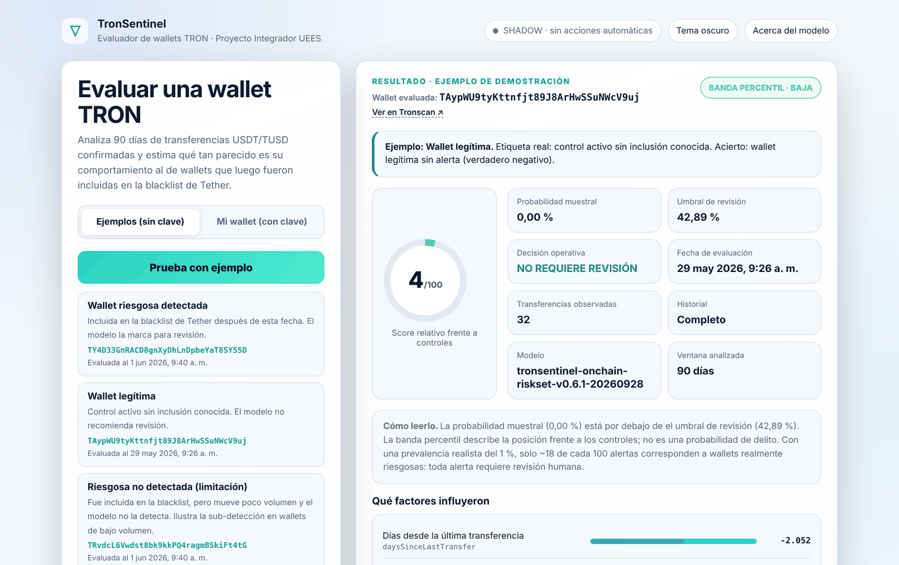

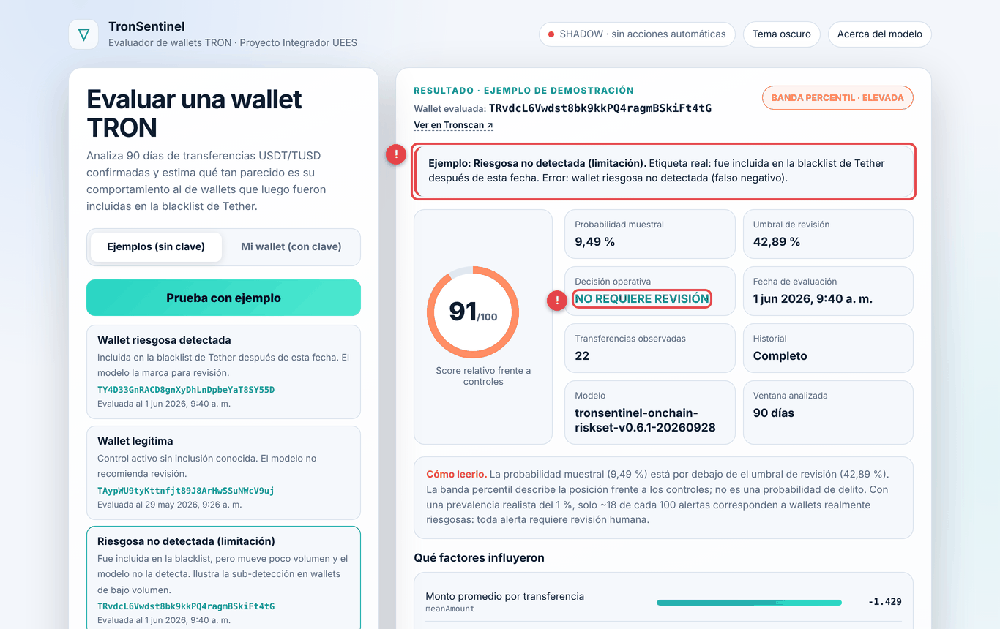

*La anotación (!) marca el error: la etiqueta real dice que fue incluida en la blacklist, pero la decisión fue "No
requiere revisión".*

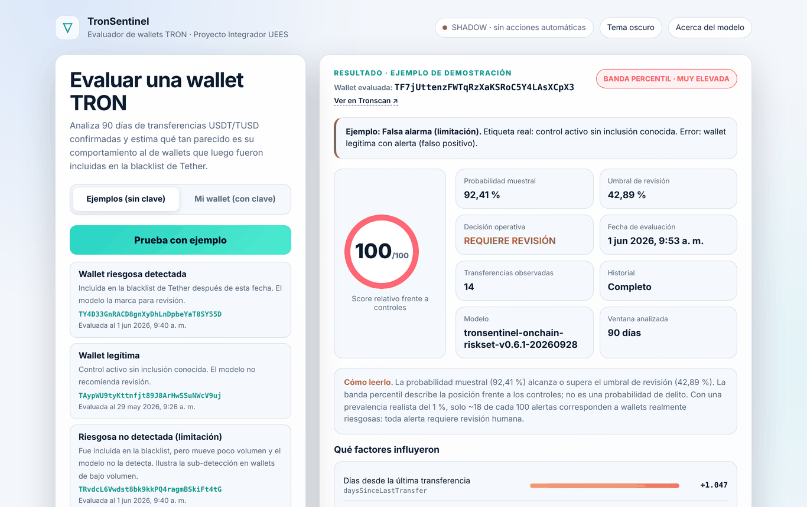

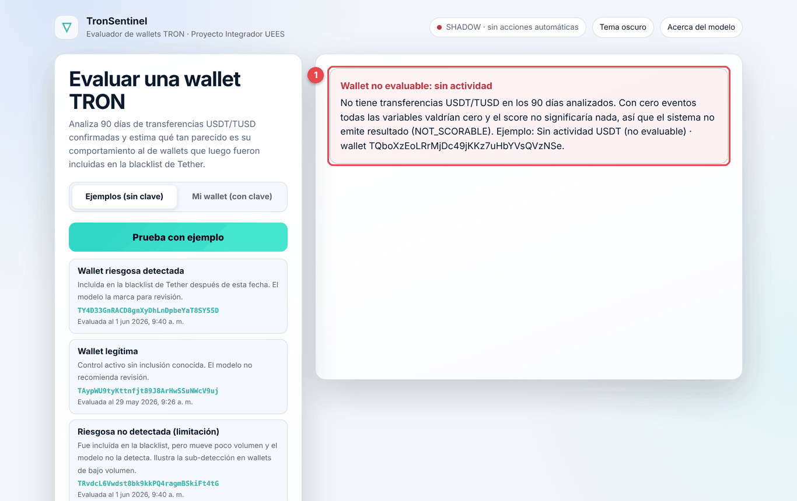

*(1) Cuando la wallet no tiene transferencias en la ventana o su historial es demasiado grande, la aplicación explica
por qué no hay score en lugar de mostrar un número sin sentido.*

## 5. Evaluar cualquier wallet (con clave)

La evaluación libre consulta TronGrid en vivo y requiere una **clave de acceso** que el equipo entrega en privado
(no está publicada en el repositorio).

1. Pulsa la pestaña **Mi wallet (con clave)**.
2. Escribe o pega la **dirección TRON**: 34 caracteres, empieza con `T`, sin `0`, `O`, `I` ni `l`.
3. Pega la **clave de acceso**. Se usa solo para esa consulta y no se guarda; el icono permite mostrarla u ocultarla.
4. Pulsa **Evaluar wallet**. La evaluación se hace a la fecha y hora actuales.

La aplicación valida la dirección antes de enviarla:

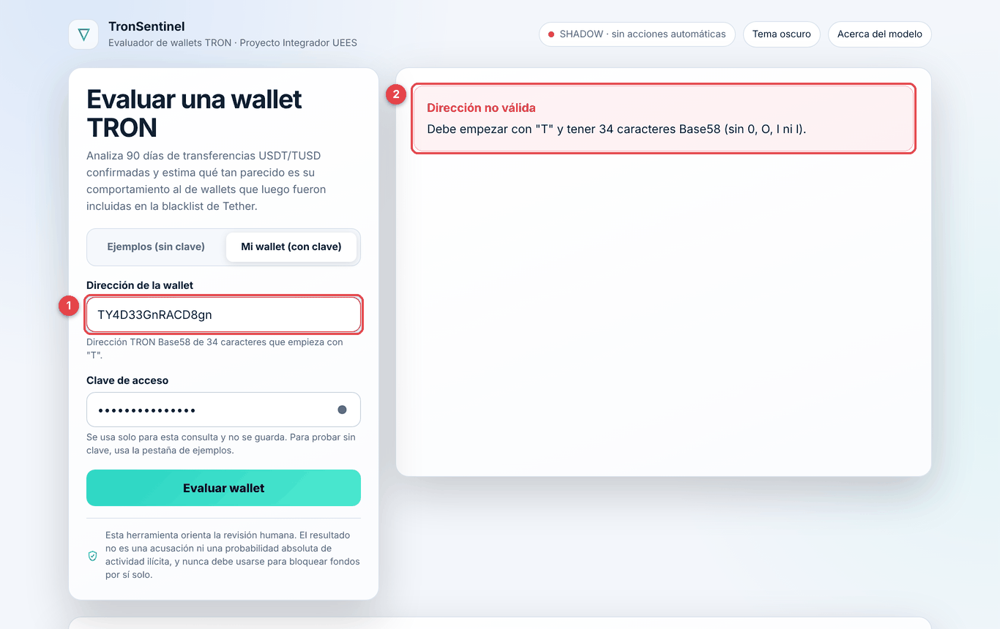

*(1) Dirección incompleta. (2) Mensaje con el formato esperado; no se hace ninguna consulta.*

Si la clave es incorrecta:

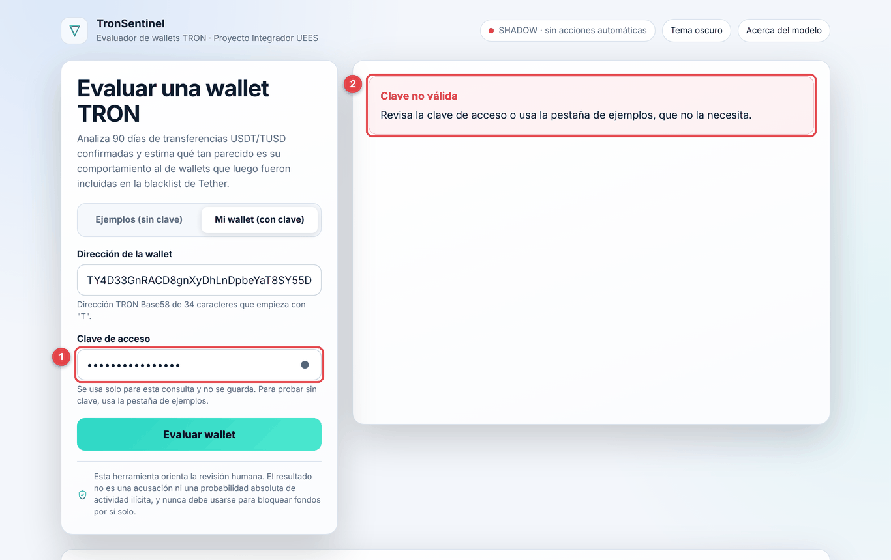

*(1) Campo de clave. (2) Mensaje "Clave no válida", con la sugerencia de usar los ejemplos, que no la necesitan.*

## 6. Exportar, copiar e historial

* **Descargar CSV**, **Guardar PDF** y **Copiar JSON** están debajo de los factores (sección 3, elementos 8–10).
* El **Historial de esta sesión** aparece al evaluar la primera wallet, sea un ejemplo o una propia; la columna **Origen** indica cuál. Haz clic en una fila para volver a ver y
  comparar ese resultado. El historial se borra al cerrar la página.

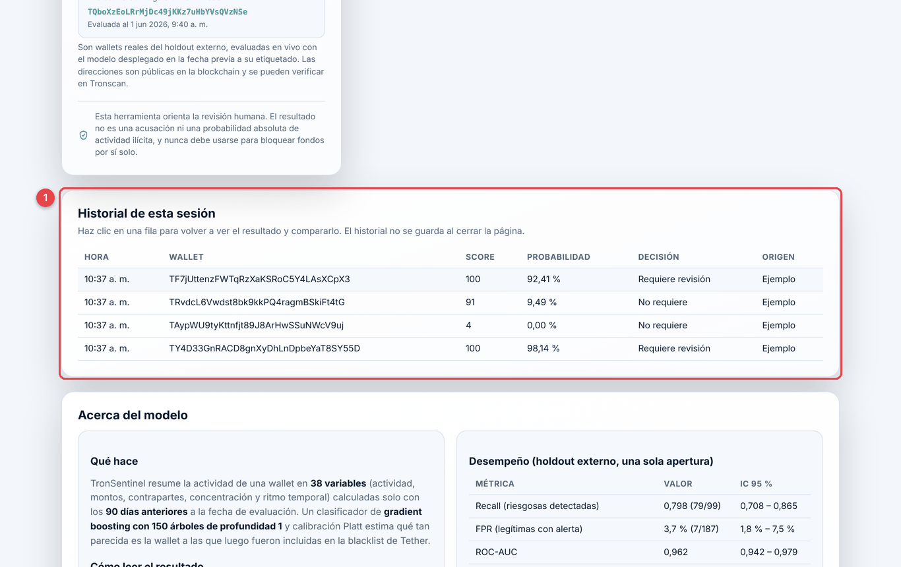

## 7. Acerca del modelo, tema oscuro y móvil

**Acerca del modelo** (botón superior derecho o desplazándose al final) resume qué hace el modelo, cómo leer el
resultado, las métricas del holdout externo con IC 95 %, la precisión esperada según la prevalencia real, las
limitaciones conocidas, los usos prohibidos y la ficha técnica que se consulta en vivo a la API.

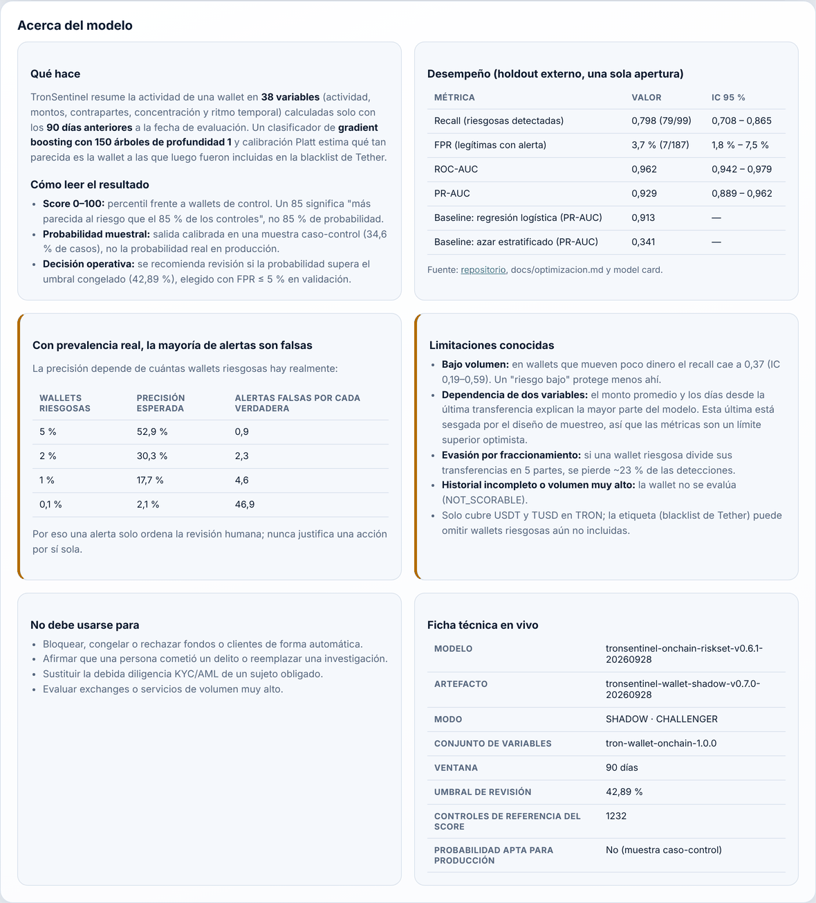

El botón **Tema oscuro** cambia la apariencia:

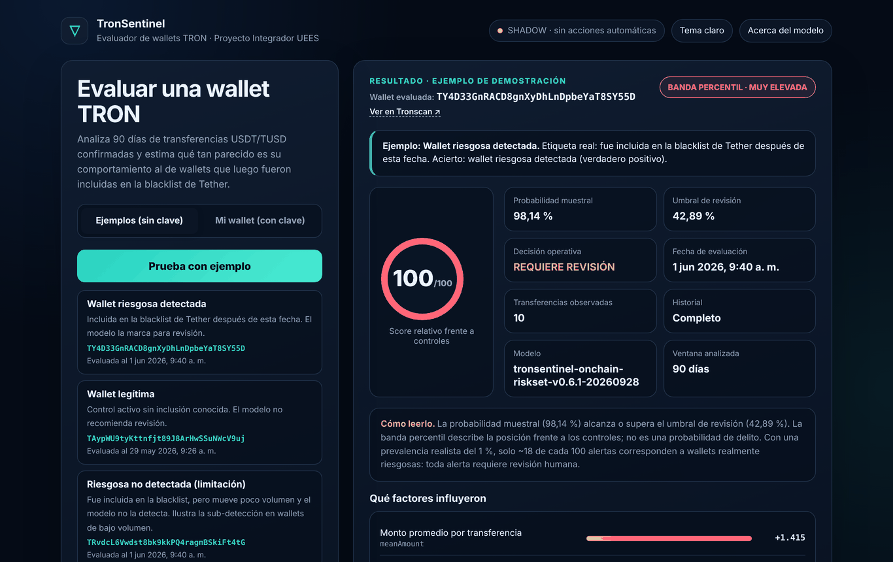

En el móvil la interfaz se reorganiza en una columna:

| Inicio | Resultado |
|---|---|
| 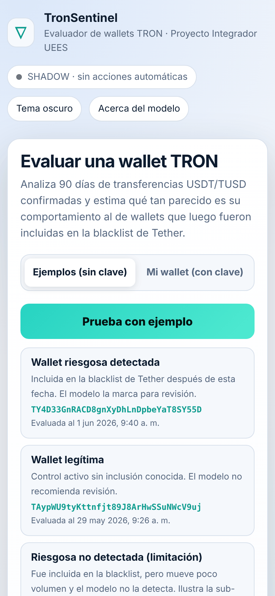 | 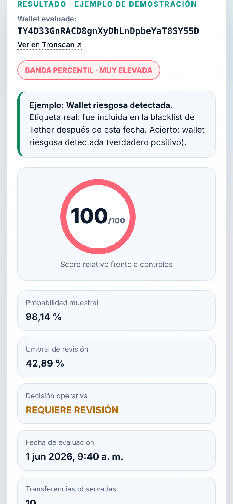 |

## 8. Evaluador local por CSV (opcional)

Para usar el modelo sin internet ni clave, con variables ya calculadas (por ejemplo, del dataset):

```bash
pip install -r app/requirements.txt
python app/app.py          # abre http://127.0.0.1:8080/local
```

* **Prueba con ejemplo riesgoso / legítimo:** carga una wallet del holdout externo y la evalúa.
* **Evaluar CSV:** sube un archivo con las 38 columnas (descarga el CSV de ejemplo desde la misma página). Máximo
  5 000 filas y 5 MB. Si una fila tiene un valor vacío, negativo o no numérico, se indica el número de fila.
* **Descargar CSV** guarda los resultados.

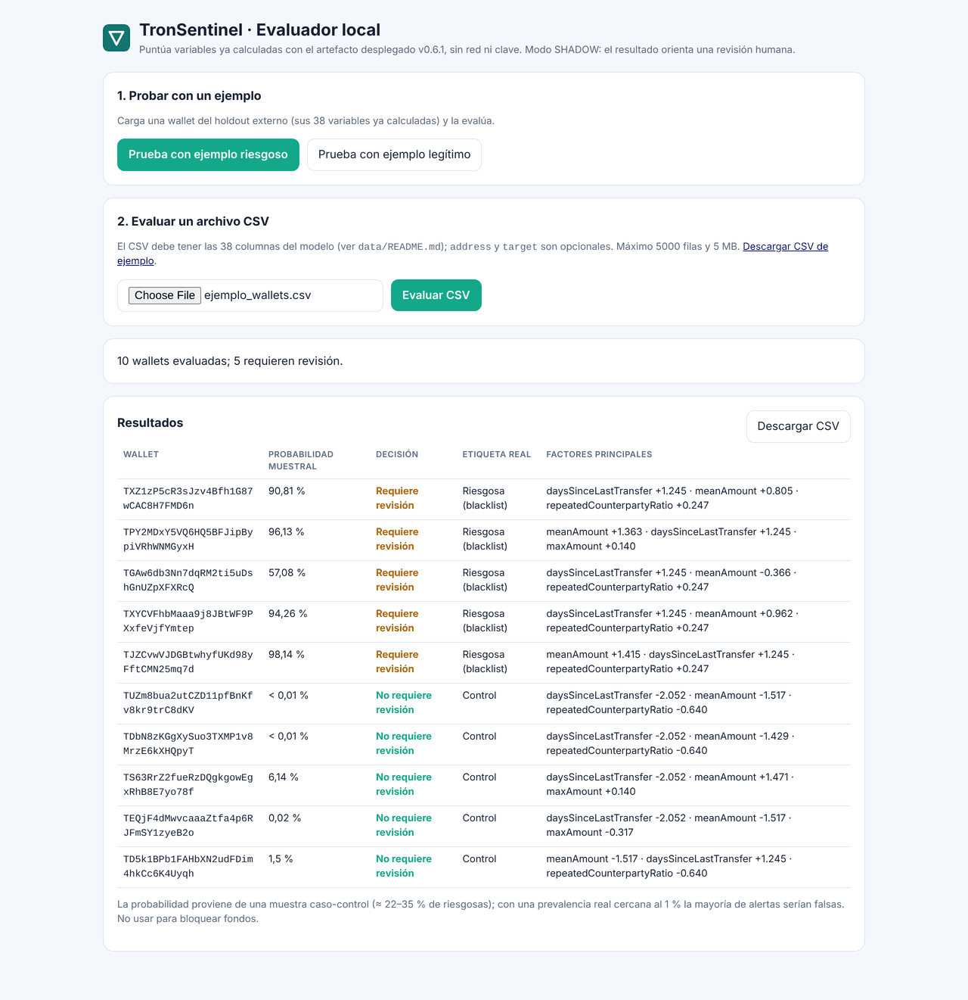

`http://127.0.0.1:8080/` sirve también la interfaz principal (que sigue usando la API en la nube).

## 9. Solución de problemas

| Problema | Causa probable | Solución |
|---|---|---|
| "Dirección no válida" | Falta o sobra un carácter, o se copió una dirección de otra red (p. ej. `0x…`) | Copia la dirección TRON completa (34 caracteres, empieza con `T`) |
| "Falta la clave" | Escribiste una dirección válida pero dejaste vacío el campo de clave | Pega la clave de acceso o usa la pestaña **Ejemplos (sin clave)** |
| "Clave no válida" | Clave incorrecta, con espacios o vencida | Vuelve a pegarla sin espacios; si persiste, solicita una nueva. Puedes usar los ejemplos sin clave |
| "Wallet no evaluable: sin actividad" | No hubo transferencias USDT/TUSD en los 90 días | Es el comportamiento esperado: no hay datos para evaluar |
| "Wallet no evaluable: volumen muy alto" | Historial demasiado grande (exchange o servicio) | El sistema no evalúa este tipo de wallets para no emitir un score incompleto |
| "Historial incompleto" | La respuesta llegó con el historial truncado | No interpretes ese resultado: es una limitación del volumen de datos. Reintenta más tarde o evalúa otra wallet |
| "Demasiadas consultas" | Se superaron 30 consultas de ejemplo en 10 minutos | Espera unos minutos |
| La evaluación tarda más de 30 s | TronGrid lento o límite de tasa | Espera y reintenta; la primera consulta tras un periodo inactivo tarda más (arranque en frío) |
| "Sin conexión con el servicio" | No fue posible contactar la API (sin internet, bloqueador de contenido o servicio caído) | Revisa tu conexión y reintenta; si persiste, recarga la página |
| "No se pudo completar la evaluación" | La API respondió con un error inesperado o falló el proveedor de datos | Reintenta en unos minutos; si se repite, abre un *issue* con el código que muestra el mensaje |
| No aparecen los ejemplos | Sin conexión a la API o bloqueador de contenido | Recarga la página; desactiva extensiones que bloqueen solicitudes |
| "No se pudo cargar la ficha en vivo" | La ficha técnica de «Acerca del modelo» consulta la API y no respondió | Recarga la página; las métricas y limitaciones de esa sección siguen disponibles |
| "No se pudo copiar" | El navegador no permite el portapapeles | Usa **Descargar CSV** o **Guardar PDF** |
| El PDF sale con otro formato | Configuración de impresión | Elige "Guardar como PDF" y desactiva encabezados del navegador |
| Evaluador local: "Faltan variables" | El CSV no tiene las 38 columnas | Usa el CSV de ejemplo como plantilla |

## 10. Preguntas frecuentes

**¿Un score de 100 significa que la wallet es criminal?**
No. Significa que se parece más a los casos de riesgo que cualquier wallet de control de referencia. La decisión de
riesgo la toma una persona revisando más evidencia.

**¿Por qué una wallet con score 91 dice "No requiere revisión"?**
El score es un percentil; la recomendación usa la probabilidad muestral frente al umbral de 42,89 %. Pueden diferir.

**¿Qué tan preciso es?**
En el holdout externo detectó 79 de 99 wallets riesgosas (recall 0,80; IC 0,71–0,87) y alertó sobre 7 de 187 legítimas
(FPR 3,7 %; IC 1,8 %–7,5 %). Con una prevalencia real del 1 % solo ~18 de cada 100 alertas serían verdaderas, y las
métricas pueden estar infladas por un sesgo de muestreo documentado.

**"No requiere revisión" ¿significa que la wallet es segura?**
No. El modelo no detecta ~20 % de las riesgosas, y muchas más si mueven poco dinero.

**¿Qué datos usa? ¿Guarda mi información?**
Solo transferencias públicas de la blockchain TRON. No pide ni guarda tu nombre, correo ni IP; la clave no se almacena.
La API registra la dirección evaluada, el resultado y la versión del modelo.

**¿Por qué los ejemplos se evalúan en una fecha pasada?**
Para mostrar lo que el modelo habría dicho **antes** de que Tether congelara la wallet, y poder comparar con la realidad.

**¿Qué es el modo SHADOW?**
El modelo produce resultados pero ninguna acción automática depende de ellos.

**¿Cada cuánto se actualiza el modelo?**
Se planifica un ciclo de reentrenamiento trimestral; un candidato solo reemplaza al actual si supera la gobernanza
([`TRAINING_GOVERNANCE.md`](TRAINING_GOVERNANCE.md)). El candidato de octubre de 2026 no la superó y no se desplegó.

**¿Funciona con Ethereum, Bitcoin u otros tokens?**
No. Solo wallets TRON y transferencias USDT/TUSD.

## 11. Soporte y contacto

* **Repositorio e incidencias:** <https://github.com/cvramire/TronSentinel-api/issues>
* **Equipo:** Carlos Vladimir Ramírez Espinoza · Madheline Katerine Torres Hallo — Proyecto Integrador en IA, UEES
* **Clave de acceso para evaluación libre:** se solicita al equipo por correo o por el canal del curso; no se publica.
* **Reportar un resultado erróneo:** abre un *issue* con la dirección, la fecha de evaluación y el JSON (botón **Copiar
  JSON**). No incluyas datos personales.
