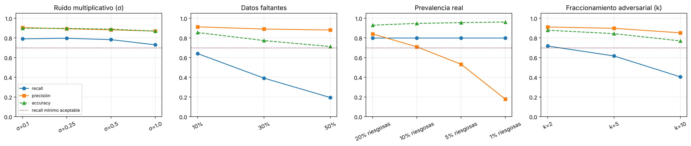
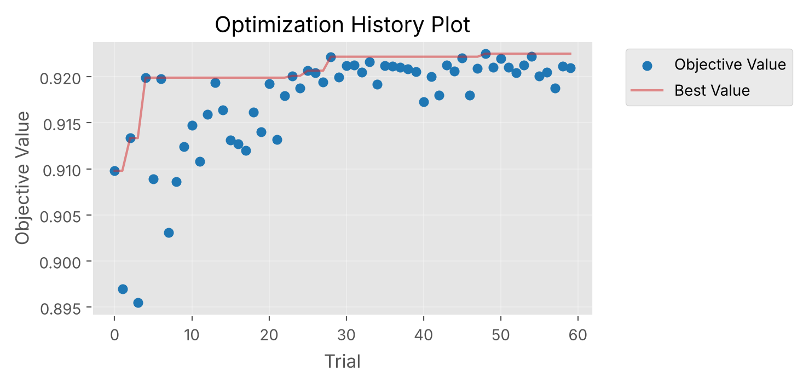
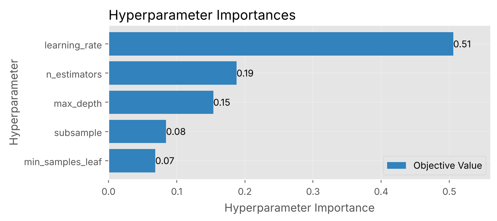
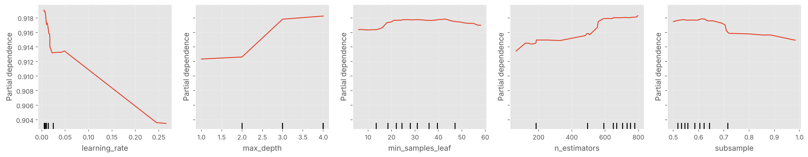
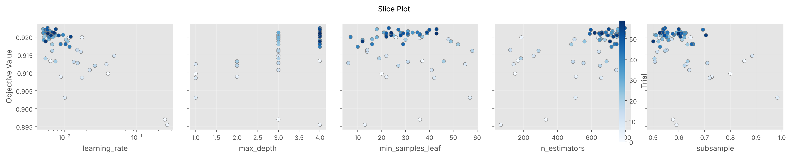
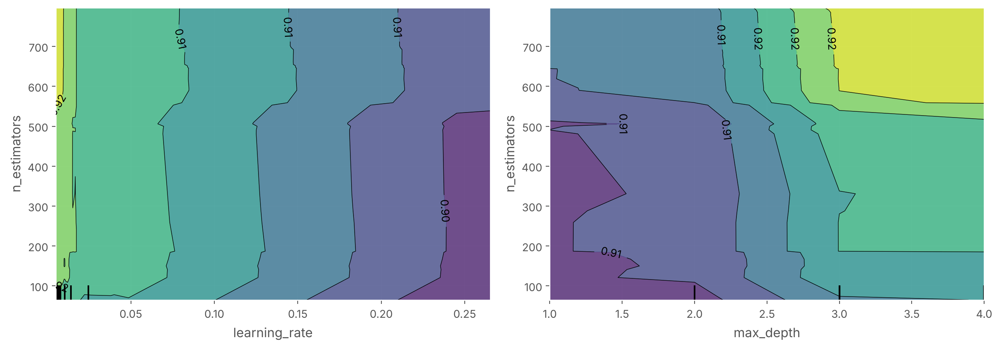
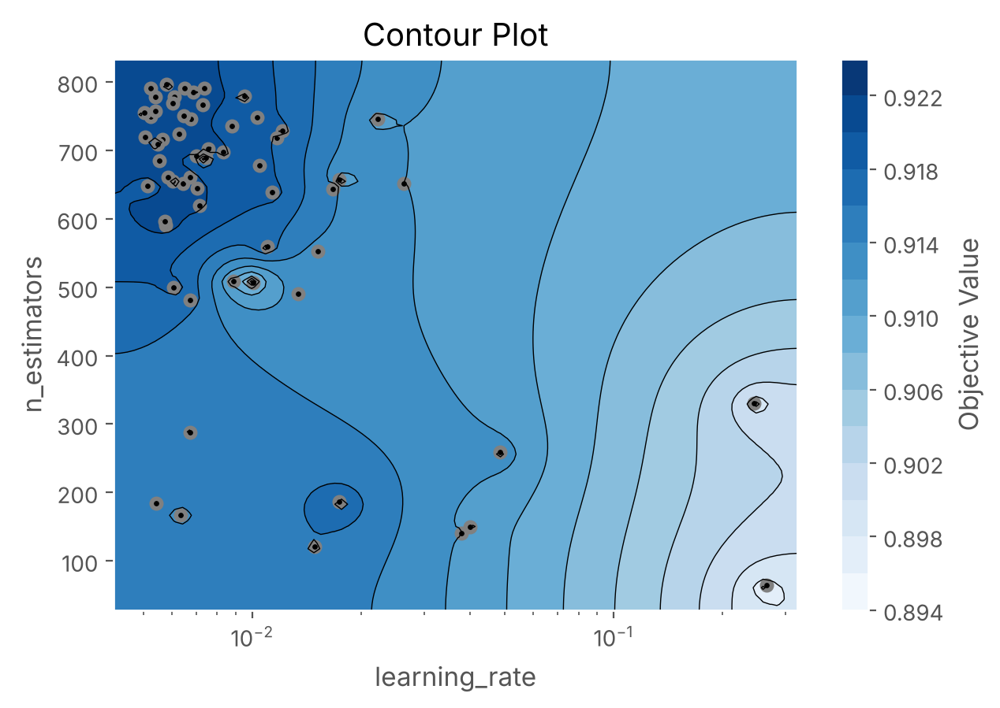

# Optimización y validación en contextos simulados (Workshop S5)

> Notebook ejecutable: [`notebooks/04_optimizacion.ipynb`](../notebooks/04_optimizacion.ipynb) · Métricas: [`results/metrics/`](../results/metrics/) · Figuras: [`results/figures/optimizacion/`](../results/figures/optimizacion/)

Este documento reúne los dos workshops de la Semana 5 aplicados a TronSentinel: la **simulación de escenarios críticos** sobre el modelo desplegado y el **análisis de sensibilidad de hiperparámetros** con Optuna. Al final, compara el modelo antes y después de optimizar.

## 1. Reglas del experimento

| Decisión | Motivo |
|---|---|
| Evaluamos el **artefacto desplegado** `tronsentinel-onchain-riskset-v0.6.1-20260928` | Se valida lo que realmente se usa, no un modelo reentrenado. |
| Búsqueda con **GroupKFold (5) por `matchedCaseId` solo sobre train** | Los casos y sus controles emparejados no pueden quedar separados entre particiones. |
| Métrica objetivo: **PR-AUC** | Las clases están desbalanceadas y la métrica no depende del umbral. El recall y el FPR se reportan en el umbral operativo. |
| Validación y holdout externo se consultan **una vez, al final** | Evita sobreajustar al conjunto de prueba. El holdout externo ya se abrió para aprobar v0.6.1, así que aquí es **solo informativo**. |
| Criterio de aceptación fijado **antes** de ejecutar: caída de recall ≤ 0,10 | Con 99 positivos, el IC 95 % del recall base tiene un semiancho de ~0,08; caídas menores no se distinguen del azar. |

**Baseline** (holdout externo, umbral congelado 0,4289):

| Modelo | Recall | FPR | Precisión | PR-AUC | ROC-AUC |
|---|---:|---:|---:|---:|---:|
| Dummy estratificado | 0,182 | 0,209 | 0,316 | 0,341 | 0,487 |
| Regresión logística (log1p + escalado) | 0,899 | 0,171 | 0,736 | 0,913 | 0,956 |
| **TronSentinel v0.6.1** | **0,798** [0,708–0,865] | **0,037** [0,018–0,075] | 0,919 | **0,929** | **0,962** |

Los IC son de Wilson. En validación cruzada agrupada sobre train, la configuración desplegada obtiene una PR-AUC de **0,910 ± 0,011**.

## 2. Workshop 1 · Escenarios críticos

| Escenario | Nivel | Recall | FPR | Precisión | PR-AUC | Veredicto |
|---|---|---:|---:|---:|---:|---|
| Base | sin perturbar | 0,798 | 0,037 | 0,919 | 0,929 | — |
| Error de medición (×e^N(0,σ)) | σ = 0,5 | 0,782 | 0,056 | 0,882 | 0,911 | OK |
| | σ = 1,0 | 0,729 | 0,058 | 0,869 | 0,889 | OK |
| Datos faltantes (imputación por mediana) | 10 % | 0,640 | 0,033 | 0,912 | 0,898 | **FALLA** |
| | 30 % | 0,391 | 0,026 | 0,889 | 0,828 | **FALLA** |
| Prevalencia real | 5 % | 0,798 | 0,037 | 0,532 | 0,683 | OK* |
| | 1 % | 0,798 | 0,037 | **0,178** | 0,418 | OK* |
| Cambio de distribución (entrenado solo con bajo volumen) | bajo volumen | 0,735 | 0,095 | 0,694 | 0,838 | referencia |
| | alto volumen | 0,954 | **0,225** | 0,795 | 0,960 | OK** |
| Variable caída (valor = mediana) | `daysSinceLastTransfer` | 0,030 | 0,000 | — | 0,801 | **FALLA** |
| | `meanAmount` | 0,000 | 0,000 | — | 0,898 | **FALLA** |
| | `repeatedCounterpartyRatio` | 0,818 | 0,064 | 0,871 | 0,919 | OK |
| **Fraccionamiento adversarial** (propio) | k = 2 | 0,717 | 0,037 | 0,910 | 0,899 | OK |
| | k = 5 | 0,616 | 0,037 | 0,897 | 0,833 | **FALLA** |
| | k = 10 | 0,404 | 0,037 | 0,851 | 0,756 | **FALLA** |

\* El recall no cambia, pero la precisión se desploma. Con 1 % de prevalencia, 82 de cada 100 alertas serían falsas, mientras la *accuracy* sube a 0,961: es una métrica engañosa con desbalance.
\** Pasa el criterio de recall, pero el FPR (22,5 %) supera el criterio de pausa de 10 % del Workshop S4.

**Escenario propio: fraccionamiento (*structuring*).** Un actor que divide cada transferencia en *k* partes multiplica sus conteos por *k* y divide entre *k* sus montos unitarios y sus tiempos entre eventos. Los totales no cambian. Con k = 5, el modelo pierde el 23 % de los casos que hoy detecta.

**Mitigaciones de los escenarios que fallan**

| Falla | Mitigación | Estado |
|---|---|---|
| Datos faltantes | No imputar en producción: historia incompleta → `NOT_SCORABLE`. Agregar validación de completitud por variable. | Implementado (`NOT_SCORABLE`); validación por variable pendiente |
| Dependencia de dos variables | Monitoreo de integridad (pausa si una variable llega nula o constante). Diversificar con variables no monetarias. Corregir el sesgo de muestreo de `daysSinceLastTransfer` con controles *random-lookback*. | Muestreo corregido para el ciclo v8 |
| Cambio de distribución | Entrenar con toda la distribución de volumen; FPR por banda en la auditoría de subgrupos; PSI sobre la mezcla de volúmenes. | Entrenamiento completo vigente; monitoreo pendiente |
| Fraccionamiento | Variables robustas a la fragmentación (contrapartes, montos por contraparte, ráfagas), aumento de datos con positivos fraccionados y advertencia en el model card. | Propuesto para v8 |

## 3. Workshop 2 · Sensibilidad de hiperparámetros

**Búsqueda:** Optuna (TPE, semilla 42, 60 pruebas; la prueba 0 es la configuración desplegada), con pesos de clase balanceados en cada partición.

| Hiperparámetro | Rango explorado | Desplegado |
|---|---|---:|
| `n_estimators` | 50 – 800 | 150 |
| `learning_rate` | 0,005 – 0,3 (log) | 0,04 |
| `max_depth` | 1 – 4 | 1 |
| `min_samples_leaf` | 1 – 60 | 20 |
| `subsample` | 0,5 – 1,0 | 0,8 |

### 3.1 Ranking de importancia (fANOVA)

| Hiperparámetro | Importancia |
|---|---:|
| `learning_rate` | **0,51** |
| `n_estimators` | 0,19 |
| `max_depth` | 0,15 |
| `subsample` | 0,08 |
| `min_samples_leaf` | 0,07 |

### 3.2 Efecto individual (partial dependence con modelo sustituto)

- **`learning_rate`:** es el efecto más fuerte. La PR-AUC baja de ~0,918 a ~0,904 al pasar de 0,005 a 0,25.
- **`max_depth` y `n_estimators`:** más profundidad y más árboles ayudan levemente (~+0,005).
- **`min_samples_leaf` y `subsample`:** curvas casi planas (< 0,002). Se pueden fijar.
- **Magnitud total:** las 60 pruebas quedan entre **0,896 y 0,923** (rango 0,027), apenas 2–3 desviaciones estándar entre particiones.

### 3.3 Interacciones

- **`learning_rate` × `n_estimators`:** contornos casi verticales, así que domina la tasa. Solo con tasas < 0,02 más árboles aportan, que es la interacción típica del boosting, aquí leve.
- **`max_depth` × `n_estimators`:** interacción clara. Profundidad 3–4 solo rinde con más de ~550 árboles; con stumps, el número de árboles casi no importa.

### 3.4 Decisiones de búsqueda

- **Ampliar:** `n_estimators` > 800 y `learning_rate` < 0,005, porque el óptimo (797; 0,0058) quedó en el borde. Es coherente con el early stopping de la Semana 3, que se detuvo entre 600 y 900 iteraciones.
- **Fijar:** `subsample` ≈ 0,6 y `min_samples_leaf` entre 20 y 40.
- **Restricción de despliegue:** `max_depth` = 1, porque el scorer TypeScript solo ejecuta stumps.

## 4. Antes y después de la optimización

Las tres configuraciones se entrenaron con todo train. El umbral de cada una se fijó en validación con FPR ≤ 5 %.

| Configuración | Parámetros | PR-AUC CV | PR-AUC validación | PR-AUC holdout | Recall holdout | FPR holdout |
|---|---|---:|---:|---:|---:|---:|
| **Desplegada (antes)** | 150 árboles, lr 0,04, prof. 1, hoja 20, sub. 0,8 | 0,910 | 0,935 | 0,929 | 0,798 | 0,043 |
| Optuna libre | 797, lr 0,0058, prof. 4, hoja 23, sub. 0,55 | **0,923** | 0,948 | 0,947 | 0,808 | 0,048 |
| Optuna stumps (desplegable) | 141, lr 0,038, prof. 1, hoja 55, sub. 0,63 | 0,912 | 0,936 | 0,924 | 0,828 | 0,059 |

**Diferencias pareadas de PR-AUC frente a la desplegada** (bootstrap agrupado, 2.000 repeticiones):

| Comparación | Validación | Holdout externo (informativo) |
|---|---|---|
| Optuna libre − desplegada | +0,013 [−0,006; 0,035] → **incluye 0** | +0,018 [0,005; 0,035] |
| Optuna stumps − desplegada | +0,001 [−0,006; 0,008] → **incluye 0** | −0,005 [−0,019; 0,003] |

**Prueba de estrés después de optimizar** (recall):

| Escenario | Desplegada | Optuna libre | Optuna stumps |
|---|---:|---:|---:|
| Sin perturbar | 0,798 | 0,808 | 0,828 |
| Ruido σ = 0,5 | 0,784 | 0,812 | 0,804 |
| Faltantes 30 % | 0,402 | **0,567** | 0,459 |
| Prevalencia 5 % (precisión) | 0,497 | 0,475 | 0,432 |
| Fraccionamiento k = 5 | 0,626 | 0,626 | 0,657 |

## 5. Configuración final y justificación

**Se mantiene la configuración desplegada** (150 stumps, lr 0,04, hoja 20, subsample 0,8):

1. **La versión desplegable optimizada no mejora:** sus diferencias incluyen cero en validación y en el holdout. La configuración actual ya está cerca del óptimo para stumps.
2. **La versión libre no demuestra mejora en el conjunto limpio:** en validación el IC incluye cero. Su ventaja en el holdout no puede usarse para elegir, porque ese conjunto ya fue consumido; hacerlo sería sobreajustar al test.
3. **No es desplegable** sin reescribir el exportador y el scorer para árboles profundos.
4. **Las vulnerabilidades importantes no dependen de los hiperparámetros:** la dependencia de dos variables, el fraccionamiento y la prevalencia real afectan a los tres modelos por igual. Se atacan con datos y variables nuevas.

**Hipótesis registrada para el ciclo v8:** árboles de profundidad 3–4 con más de 550 árboles y tasa < 0,01, con early stopping externo. Se evaluaría con una cohorte nueva, ya que la mejora de +0,013 no está demostrada. Antes requiere adaptar el exportador y el scorer TypeScript.

## 6. Relación con el resto del proyecto

- **Semana 3 (overfitting):** el early stopping predefinido eligió entre 600 y 900 iteraciones. La sensibilidad confirma que el número de árboles importa más que la regularización por hoja o submuestreo.
- **Workshop S4 (ética):** los escenarios C (prevalencia) y D (FPR por subgrupo) cuantifican los riesgos de falsos positivos y de desempeño desigual, y justifican los criterios de pausa.
- **Ciclo v7:** el colapso al quitar `daysSinceLastTransfer` es coherente con el sesgo de muestreo detectado en ese ciclo.

*Reproducibilidad:* scikit-learn 1.9.1, Optuna 5.0.0, Python 3.13. Semillas: modelo 20260927 y Optuna 42. Tiempo de ejecución: ~10 minutos en 2 CPU.
